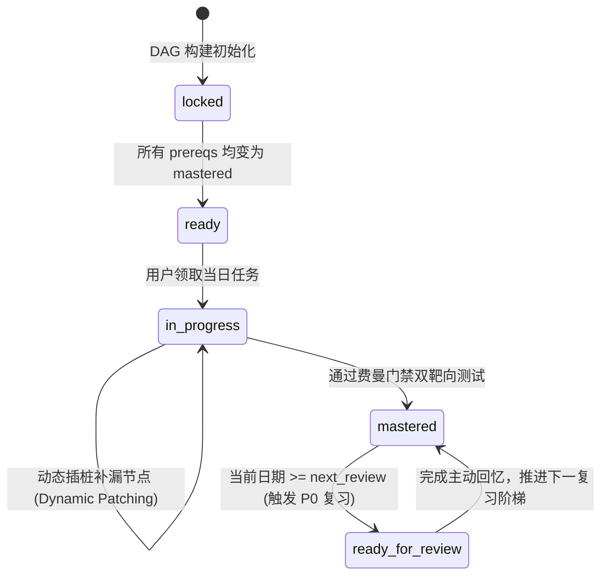
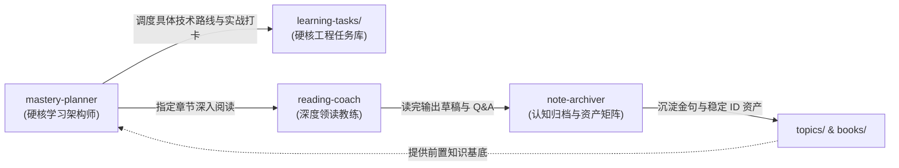

# Mastery Planner 架构设计规范与决策原件 (Design RFC & Rationale)

> **文档版本**：v1.0.0  
> **归属工程**：`bookReadingNote` 知识与实战工程库  
> **定位**：硬核技术学习规划器 `mastery-planner` 的架构单一事实源（SSOT）、设计哲学、第一性原理裁决与推演留痕。

---

## 1. 背景与核心问题意识 (Context & Problem Statement)

在 Agent Skills 开源生态中，存在大量关于“学习规划”的开源实现，大致可归为 7 大范式：
1. **阶段里程碑型**（如 `learn-anything-roadmap`）：三段式拆解，强调终极目标与剪枝；
2. **严格工时核算型**（如 0xBakeer 的 `study-plan`）：时间算术、反低效重读、难点前置；
3. **本地状态持久化型**（如 Anthropic 的 `study-plan`）：YAML 跨会话记忆与动态加权；
4. **依赖图驱动型 (DAG Planner)**：前置条件拓扑倒推，阻断概念断层；
5. **代码库/项目驱动型 (Learn-by-Building)**：拒绝空谈，以最小可运行原型 (MVP) 和代码改动为核心；
6. **费曼/苏格拉底门禁型 (Socratic Gatekeeper)**：边界条件与机理反问，验收不通过不解锁；
7. **间隔重复闭环型 (Spaced Repetition)**：结合记忆曲线与错题卡片，动态复习。

### 为什么不能简单“全装”？（避免反模式）
如果在单个 Agent 宿主中同时安装 4~5 个上述独立 Skill，会引发两个致命工程缺陷：
- **上下文抢占与指令互斥**：用户说“帮我安排今天的学习”，多个 Skill 的 Description 相互竞争，触发条件模糊，导致调用不稳定；
- **状态严重割裂**：DAG Skill 拆解出的节点拓扑，工时排期 Skill 无法感知；门禁 Skill 考出的盲区，复习调度 Skill 无法将其自动插回排期；跨会话丢失上下文。

因此，我们必须基于**第一性原理**打造一个自治内聚的单一闭环——**`mastery-planner`**。

---

## 2. 核心设计目的 (Goals & Non-Goals)

### 2.1 想达成的目的 (Core Objectives)
1. **粉碎“懂了的错觉” (Illusion of Competence)**：杜绝一切“阅读完某章节”、“看了某视频”等无法证伪的假学习。每一个学习节点必须绑定**可观测的中间交付物**（终端日志、通过的单测、崩溃现场或机理推导手稿）。
2. **彻底消灭跨会话失忆 (Zero Cross-Session Amnesia)**：通过本地持久化 `study-state.yaml`，无论新开多少轮对话，Agent 读取文件即可秒级恢复状态，知道昨天攻坚到了哪一步、哪个概念答错了、今天该复习什么。
3. **工时与精力的真实保护 (Cognitive Budget Guard)**：承认人类精力的有限性。拒绝“大而全的空头支票计划”，每日任务严格限定在用户真实可用分钟数内；利用“难点前置”将高认知负荷任务安排在精力峰值，并强制预留 15~20% 给到期复习。
4. **认知盲区的自愈与闭环 (Closed-loop Self-healing)**：未通过门禁验收的节点，其盲区必须作为结构化数据存底，并在依赖图中**动态插桩补漏子节点**，实现自我修正。

### 2.2 明确不做的事情 (Non-Goals / Anti-Goals)
- **不做快餐书摘与泛泛导读**：单章节文本导读由专职教练 `reading-coach` 负责，`mastery-planner` 不介入单章细碎文本的拆解。
- **不做无止境的微观工时算术拉扯**：不搞精确到 1 分钟的机械计时（如“9:00-9:13 做 A，9:13-9:27 做 B”），避免陷入繁琐的元工作（Meta-work）内耗。
- **不做数十节点的巨型拓扑玩具**：单主题骨干节点严格限制在 6~10 个，过大的图只会带来维护灾难和弃坑心理。
- **不引入重型外部运行时依赖**：不强制依赖外部 AnkiConnect、数据库或复杂 Python 环境，保持原生纯文本与 YAML 文件驱动 (KISS 原则)。

---

## 3. “取其精华，去其糟粕” 裁决逻辑 (Rationale Matrix)

| 原始范式 | 萃取的“精华” (Adopted) | 剔除的“糟粕” (Discarded) | 为什么这么决策？ (Architectural Why) |
| :--- | :--- | :--- | :--- |
| **阶段拆解 (Roadmap)** | **阶段化划分 + Explicit Cut-list**（明确剪枝清单）。 | 纯线性分期推进。 | 真实技术掌握往往存在前置交叉依赖，纯线性阶段会产生逻辑死锁；但 Explicit Cut-list 极度关键，是防止“顺便学学这个”导致目标崩塌的核心盾牌。 |
| **严格工时 (Study-Plan)** | **真实净时间封顶 + 难点前置攻坚**。 | 繁琐的分钟级算术拉扯、考证式机械刷题。 | 认知科学表明：精力最好的时候啃最硬的骨头收益最高；超时计划是放弃学习的主因。但无需苛求分钟级绝对精确，抓大放小。 |
| **YAML 状态机** | **单一事实源 (SSOT) 本地持久化**。 | 原版面向法条考试，无工程实践属性。 | 本地 YAML 文件无缝契合 Git 版本控制，可追溯、可审查、跨 LLM 会话零信息损失。 |
| **前置依赖 (DAG)** | **拓扑排序与依赖倒推**。 | 动辄几十个节点的巨型网状图。 | 前置不清是学硬核知识卡死的最主要原因；但人类大脑短时记忆与项目生命周期有限，6~10 个骨干节点足以覆盖一个 MVP。 |
| **代码/项目驱动** | **代码/命令/现象作为一等公民**。 | 将理论思考与数学推导完全排斥在外。 | 抽象为“可观测交付物 (Observable Output)”，写代码要求断点与单测，纯理论要求推导手稿与反例构建，统一检验标准。 |
| **费曼/苏格拉底门禁** | **机理反问 + 边界刺探双探针**。 | 考官死板卡人、无休止的主观挑刺。 | 标准化为 2 个具体反问，答不上来记录在案并触发降解插桩，杜绝主观模糊评价。 |
| **间隔重复** | **复习任务优先级 P0，开局先算复习**。 | 复杂的 SM-2/FSRS 浮点数算法与外部软件绑定。 | 本地实现轻量级 `1d -> 3d -> 7d -> 14d` 固定阶梯，5 分钟主动回忆抽问，既能满足记忆固化，又极大降低系统熵增。 |

---

## 4. 状态机与生命周期设计 (State Machine Specification)

### 4.1 节点状态流转图 (Node Lifecycle)

### 4.2 费曼门禁的双靶向探针设计原则
门禁提问**严禁**使用“请谈谈你对 X 的理解”、“X 有什么特点”等宽泛陈述题。必须遵循双探针规范：
- **探针 1（底层运行时机理）**：深入一层。例：“当你在 Rust 里调用 `pin!` 宏时，它是在栈上还是堆上分配的？底层指针结构如何保证不被 move？”
- **探针 2（破坏性边界刺探）**：抽掉支柱。例：“如果取消 `T: Unpin` 的约束，直接允许通过解引用拿到 `&mut T`，请手写一段代码演示由此引发的内存段错误 (Segfault)。”

### 4.3 启发式引导缓冲机制 (Hint Buffer Rationale)
- **拒绝冷酷死锁**：真实学习中，学习者在被深挖底层时可能出现一时卡壳或表述偏颇。若立即判定挂科、记录盲区，会极大打击心流；
- **双段式裁决**：首次答偏时，考官先退一步给出 1 个关键反例或线索（启发式缓冲），倒逼其自主调动神经元完成二次推导；若仍抓不住本质，才判定未通过，确保门禁严谨而不失温度。

### 4.4 路径就近内聚与多主题隔离设计 (Path Locality)
- **避免根目录污染**：如果所有主题的状态都写在根目录 `./study-state.yaml`，多主题并发（如同时推进游戏引擎与分布式存储）必然产生严重覆盖冲突；
- **资产同生共死**：将实战项目就近安放在 `learning-tasks/<topic-slug>/study-state.yaml`，实战代码、测试用例、笔记与状态文件在同一目录下自治内聚，天然契合本仓库的工程结构。

### 4.5 只读全景透视看板 (Status Overview)
- **状态不写入原则**：提供专门的只读模式（Mode 4: `--status`），用户任何时候想检视进度（例如隔周复盘）无需触发任务分配或状态写回，纯透视 DAG 进度条与到期复习清单。

---

## 5. 与本知识库 (`bookReadingNote`) 现有生态的协作关系

`bookReadingNote` 库内三大 Skill 各司其职，构成“长线规划 → 章节精读 → 资产沉淀”的铁三角闭环：

- **`mastery-planner`**：负责 **全局拓扑 (Macro Roadmap)**、工时预算保护、DAG 状态流转与通关门禁；
- **`reading-coach`**：负责 **微观领读 (Micro Reading)**、单章节 4 维探照灯提问、原文感知与读中引导；
- **`note-archiver`**：负责 **事后沉淀 (Post-Study Archival)**、资产稳定 ID 赋予、Socratic 留痕与 Inbox Zero。

---

## 6. 演进与维护守则 (Maintenance Rules)

1. **状态文件安全性**：`study-state.yaml` 必须包含版本头或遵循严格 schema，每次读取做格式防御，防止因意外编辑导致状态丢弃；
2. **渐进式演进**：当用户在使用中纠偏或提出新习惯时，通过 `/yuex-skill-doctor mastery-planner --archive` 沉淀黄金样本，保持技能自愈力。

---

## 7. Mastery Planner v2.0 架构升级决策留痕 (Doctor Approved RFC)

> **评审时间**：2026-11-24  
> **审查机构**：`yuex-skill-doctor` (Agent Skills 架构审查总局)

### 7.1 升级动因与现实摩擦剖析
v1.0 状态机虽具备高度完备的 DAG 拓扑与双探针门禁，但在真实学习场景中暴露了三大摩擦点：
1. **冷启动高摩擦**：让学习者对着空白文件自行搭建测试环境，极易触发认知拖延；
2. **卡壳缺乏逃生通道**：原版在答不上来时仅记录 `weak_points`，无法提供递进式认知降维引导；
3. **僵化与孤岛效应**：固定工时无法应对真实碎片时间，通关顿悟缺乏标准化递交格式。

### 7.2 审查裁决与工程取舍 (Accepted vs Rejected)

| 提案机制 | Doctor 裁决 | 最终实现方案 | 架构裁定理由 (Architectural Rationale) |
|---|---|---|---|
| **TDD 红灯测试脚手架** | 🟢 **通过 (P0)** | 派工时输出单文件、必定报错的微型测试脚手架代码。 | 击碎“假学”错觉，将模糊心智转化为“单测红转绿”的确定性闭环。 |
| **三阶认知降阶梯** | 🟢 **通过 (P0)** | 卡壳时触发：机理剥离 → 最小反例 → 具象隐喻。 | 补齐异常分支自愈能力，严禁生硬判死，赋予状态机弹性。 |
| **顿悟反刍自动转正** | 🟡 **修正通过** | 输出标准候选卡片建议稿，提示调用 `note-archiver` 归档。 | **严禁直接越权改写文档**！严格捍卫 R2 单一职责与 R3 排他边界。 |
| **工时弹性三档位** | 🟢 **通过 (P1)** | 支持 `--quick` (15m)、默认 (60m)、`--hack` (120m)。 | 适配现实时间波动，严禁引入繁琐分钟级算术。 |
| **多任务半衰期看板** | 🔴 **否决复杂版** | 降级为同级目录扫描，超 7 天仅标记单行轻量警告。 | 坚决砍掉复杂数学衰减模型，恪守 KISS 原则，防止 Token 与 Prompt 膨胀。 |
