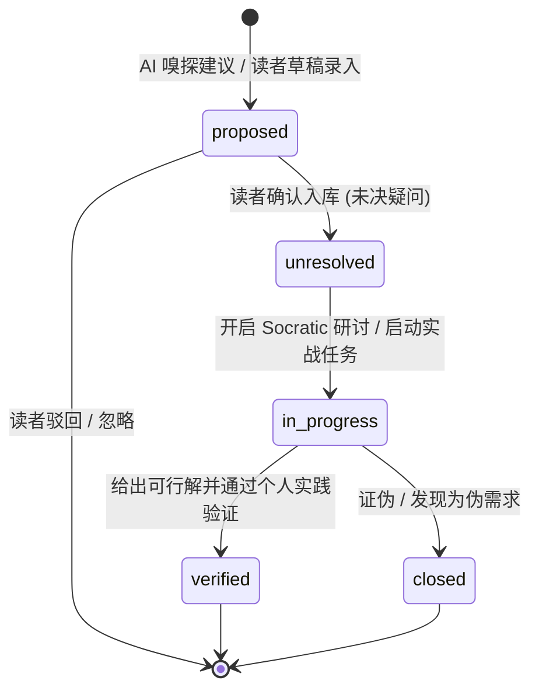

# 资产可召回性与状态机规范 (Retrieval & State Engine Spec)

> 本规范定义知识库中所有衍生资产（Q&A 研讨、金句卡片、实战任务、概念冲突）的**稳定标识、生命周期状态与检索规则**，确保资产在数月后依然能被快速召回和调用。

---

## 1. 稳定标识生成规范 (Stable ID)

所有正式入库的资产必须具备全局唯一、可预测的稳定 ID：

| 资产类型 | ID 命名规则 | 示例 | 说明 |
| :--- | :--- | :--- | :--- |
| **Q&A 研讨** | `QA-<book_abbr>-<chXX>-<seq>` | `QA-PRESENTER-CH02-01` | 绑定书籍缩写、章节与序号，避免散落 |
| **金句卡片** | `Q-<domain_code>-<seq>` | `Q-MIND-01`, `Q-SYS-02` | 按认知板块划分序号，在 quotes-matrix 中常驻 |
| **实战任务** | `DRILL-<domain_code>-<seq>` | `DRILL-PRESENTER-01` | 对应 learning-tasks 下的打卡任务 |
| **跨书争议** | `CONFLICT-<concept>-<seq>` | `CONFLICT-CONSENSUS-01` | 记录多本书在同一问题上的对立观点 |

---

## 2. 统一资产状态机 (Asset Lifecycle State Machine)

所有 Q&A、实战任务、未决疑问必须标记明确状态，杜绝死库：

- **`proposed`（建议稿）**：AI 自动嗅探出的金句或任务，须经读者确认才转正；
- **`unresolved`（未解决）**：读者记录的未决痛点或疑问，等待破局；
- **`in_progress`（推进中）**：正在进行研讨或实战打卡验证；
- **`verified`（已验证闭环）**：经过实战或代码验证有效的认知资产；
- **`closed`（关闭/归档）**：已无现实意义的旧问题。

---

## 3. 多维召回检索矩阵 (Recall Triggers)

为防止“存后吃灰”，建立以下 4 级召回机制：

1. **按场景快速查（Index Jump）**：
   - 依赖 [`topics/quotes-matrix.md`](../../topics/quotes-matrix.md) 顶部的场景速查表。
2. **按状态过滤（Status Query）**：
   - 读者随时指令：“*列出所有状态为 `in_progress` 的实战任务*” 或 “*还有哪些 `unresolved` 的核心疑问？*”。
3. **跨书概念唤醒（Concept Trigger）**：
   - 当进入新书涉及相同标签时（如 `#注意力机制`、`#分布式容错`），AI 自动召回历史 Q&A 或金句作为前置认知支架。
4. **度量指标（Cognitive Metrics）**：
   - **问题闭环率**：$\frac{\text{verified 状态数}}{\text{总研讨问题数}}$；
   - **金句被引用次数**：金句在博客、分享、新笔记中出现的频率；
   - **任务完成率**：完成验收的实战任务比例。
