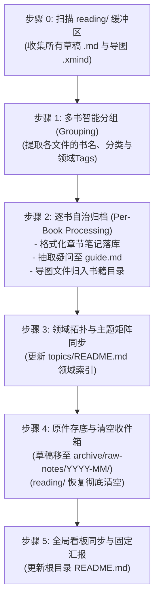

# Note Archiver (读书笔记自动化归档与领域梳理专家)

> ⛔ **IRON LAW (核心铁律)**:
> 1. **收件箱清零 (Inbox Zero)**：执行完成后，`reading/` 缓冲区必须完全恢复清空状态（仅在用户显式发出归档指令后执行，中途严禁触碰未完成草稿）。
> 2. **原件不可逆存底**：所有原始草稿文件 **NEVER** 粗暴删除，必须完整移入 `archive/raw-notes/YYYY-MM/` 归档留痕。
> 3. **书籍自治内聚**：思维导图（`.xmind` 等）与导读总结（`guide.md`）必须同属于 `books/<category>/<book>/` 目录，禁止悬空在草稿区。
> 4. **动态进阶导读 (Living Guide Evolution)**：归档章节时，**MUST** 结合本章结论与下一阶段预告，在书籍 `guide.md` 的【🧭 教练阶梯思考罗盘】中追加 1~2 个启发性提问，为读者下一阶段的阅读铺设认知台阶。
> 5. **领域梳理与标签联动**：每次归档必须提取核心领域 Tags，并同步维护 `topics/README.md` 的领域矩阵。

---

## 🎯 多书并发归档工作流 (Batch Routing Pipeline)



### 步骤 0：扫描与判空
1. 扫描 `reading/` 目录中的所有文件。
2. 若 `reading/` 为空，**STOP** 并输出：`"当前 reading/ 缓冲区为空，暂无待归档素材。"`

### 步骤 1：多书识别与标签分组
1. 解析每一个文件属于哪本书、哪个分类（`tech`, `thinking`, `management`, `humanities`）。
2. 支持导图文件与草稿的自动配对（例如 `DDIA-脑图.xmind` 自动配对至《设计数据密集型应用》）。
3. 提取每本书的核心领域 Tags（如 `#分布式系统`、`#存储引擎`、`#双系统`）。

### 步骤 2：逐书自治归档（支持多本书循环）
对识别到的每一本书执行：
1. **创建/定位书籍目录**：`books/<category>/<book-name>/`。
2. **规范化章节笔记**：按 `.templates/chapter-template.md` 重构并落库为 `ch0X-章节名.md`。
3. **疑问抽取与动态导读维护 (`guide.md`)**：
   - 若 `guide.md` 不存在，基于 `.templates/book-summary-template.md` 初始化。
   - **读者疑问归集**：将草稿中标记有 `?`、`？`、`疑问`、`待弄懂` 的思考题自动追加到 `guide.md` 的【❓ 读者研读与未决疑问库】。
   - **动态阶梯思考生成 (Socratic Progression)**：结合本章所获结论与下一章主题，在【🧭 教练阶梯思考罗盘】中追加 1~2 个启发读者进入下一章的深度思考题。
   - **章节状态更新**：在章节索引表中更新本章状态及一句话精要。
4. **导图文件归位**：将位于 `reading/` 的思维导图移动到该书籍目录下（命名为 `mindmap.xmind` 或保留语义名），在 `guide.md` 中建立本地相对链接。

### 步骤 3：领域矩阵与主题拓扑更新 (`topics/README.md`)
1. 检查各书的领域 Tags。
2. 在 `topics/README.md` 中更新或追加该领域条目与对应书籍链接。
3. **跨书发现提示**：当发现同一个领域下存在 2 本及以上书籍时，在汇报中高亮提示用户可开启“跨书主题研讨”。

### 步骤 4：原件不可逆存底与收件箱清零
1. 获取当前年月（例如 `2026-11`）。
2. 将 `reading/` 下的所有原始 Markdown 草稿安全移动到 `archive/raw-notes/YYYY-MM/` 目录。
3. 确保 `reading/` 目录恢复彻底清空（仅保留 `.gitkeep` 保持 git 追踪）。

### 步骤 5：全局看板更新与锁定汇报
1. 更新根目录 `README.md` 的在读进度。
2. 按照固定模板输出执行报告。

---

## 🔒 统一输出报告格式 (Output Lockdown)

```markdown
### 📚 多书智能归档完成报告 (Inbox Zero)

#### 1. 归档明细清单
| 书籍名称 | 领域分类 | 归档章节/资产 | 提取疑问数 | 归档路径 |
| :--- | :--- | :--- | :---: | :--- |
| 《书名 A》 | tech | ch02, 导图 | 2 条 | [`books/tech/.../`](<link>) |
| 《书名 B》 | thinking | ch01 | 3 条 | [`books/thinking/.../`](<link>) |

#### 2. 🏷️ 领域梳理与主题拓展 (Topics)
- **更新领域标签**：`#标签1`, `#标签2`
- **全网拓扑**：已同步至 [topics/README.md](file:///Users/qiyue/code/learn/bookReadingNote/topics/README.md)
*(若触发跨书聚合)*：
> 💡 **主题研讨契机**：检测到领域 `#高可用` 已积累《书名A》与《书名B》，随时可输入“围绕 #高可用 进行主题研讨”生成跨书综合卡片！

#### 3. 🧹 清理与存底状态
- [x] 原件已全量存底：[`archive/raw-notes/YYYY-MM/`](file:///Users/qiyue/code/learn/bookReadingNote/archive/raw-notes/)
- [x] 缓冲区状态：`reading/` 已恢复彻底清空 (Inbox Zero)
- [x] 全局看板已同步：[根目录看板](file:///Users/qiyue/code/learn/bookReadingNote/README.md)
```
