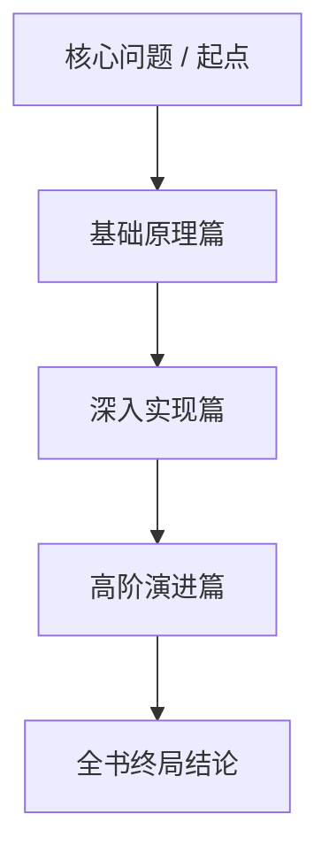

# 《{{BOOK_NAME}}》导读与全书精要

> **一句话定位**：{{ONE_SENTENCE_SUMMARY}}

---

## 🗺️ 全书全景与思维导图 (Mindmap & Overview)

- 📊 **常驻思维导图**：[点击打开思维导图 (持续演进)]({{MINDMAP_PATH}})
- **知识主干架构图**：

---

## 🧭 导读建议与阅读路径 (Reading Guide)

* **初学者 / 30分钟快速了解**：
  - 重点阅读：[第 1 章](./ch01-xxx.md)、全书终章总结
  - 核心关注：作者的根本假设与解决的问题范式
* **实战开发者 / 针对性攻坚**：
  - 重点阅读：[第 X 章](./ch0X-xxx.md)、[第 Y 章](./ch0Y-xxx.md)
  - 核心关注：工程实现权衡与实操踩坑
* **选读与跳过建议**：
  - 说明哪些章节数学/理论推导偏多，可按需选读。

---

## 📑 章节直达索引与精粹 (Chapter Index)

| 章节编号 | 章节名称 | 核心一句话结论 | 状态 | 笔记链接 |
| :--- | :--- | :--- | :--- | :--- |
| 第 1 章 | {{CH1_TITLE}} | {{CH1_SUMMARY}} | ✅ 已完成 | [阅读笔记](./ch01-xxx.md) |
| 第 2 章 | {{CH2_TITLE}} | {{CH2_SUMMARY}} | 🔄 进行中 | [阅读笔记](./ch02-xxx.md) |

---

## ❓ 全书研讨与未决疑问库 (Questions & Inquiries Backlog)
> 本模块由 `note-archiver` 自动汇总自各章节的疑问与批判性反思，作为二轮复盘或实战验证的研究课题。

### 来自第 1 章：
- [ ] **疑问 1**：{{Q1}}
- [ ] **疑问 2**：{{Q2}}

---

## 💡 终极思考与认知升级 (Synthesis & Retrospective)
* **核心认知转变**：阅读前与阅读后，思维模式发生了什么根本变化？
* **最精彩的洞见**：
* **局限性与不足**：本书在当下时代或特定场景下的边界与过时之处。
