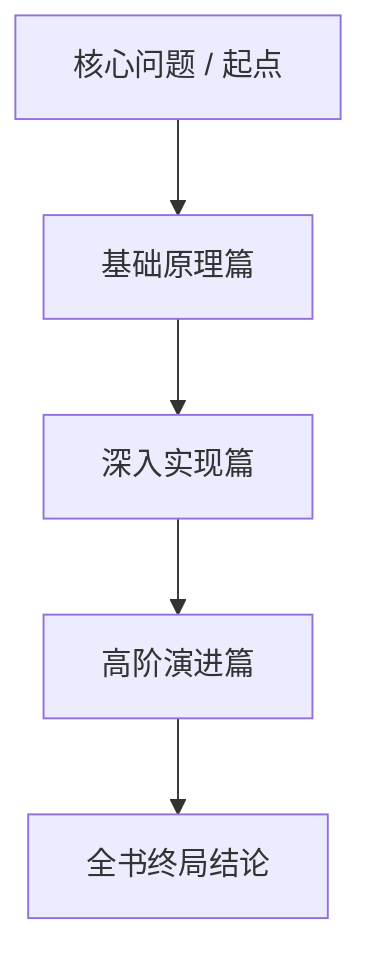

# 《{{BOOK_NAME}}》导读与全书精要

> **一句话定位**：{{ONE_SENTENCE_SUMMARY}}

---

## 🗺️ 全书全景与思维导图 (Mindmap & Overview)

- 📊 **常驻思维导图**：[点击打开思维导图 (持续演进)]({{MINDMAP_PATH}})
- **知识主干架构图**：

---

## 🧭 导读建议与阅读路径 (Reading Guide)

* **极速通读（建议 1~2 周）**：
  - 重点阅读：[第 1 章](./ch01-xxx.md)、全书终章总结
  - 核心关注：作者的根本假设与解决的问题范式
* **攻坚与实战重点**：
  - 重点阅读：[第 X 章](./ch0X-xxx.md)

---

## 📑 章节直达索引与精粹 (Chapter Index)

| 章节编号 | 章节名称 | 核心一句话结论 | 状态 | 笔记链接 |
| :--- | :--- | :--- | :--- | :--- |
| 第 1 章 | {{CH1_TITLE}} | {{CH1_SUMMARY}} | ✅ 已完成 | [阅读笔记](./ch01-xxx.md) |
| 第 2 章 | {{CH2_TITLE}} | {{CH2_SUMMARY}} | 🔄 进行中 | [阅读笔记](./ch02-xxx.md) |

---

## 🧭 教练阶梯式思考罗盘 (Evolving Socratic Compass)
> 动态进化机制：随着章节的推进，AI 在每次归档后在此抛出 1~2 个针对下一阶段的深度思考题，作为进入下一章的认知支架。

### 阶段 1：读前与宏观框架
- [x] **思考题 1**：作者试图解决什么根本矛盾？全书分成了哪几大支柱来论证？
- [ ] **思考题 2（动态生成）**：{{EVOLVING_QUESTION_1}}

---

## ❓ 读者研读与未决疑问库 (Questions & Inquiries Backlog)
> 本模块由 `note-archiver` 自动汇总自读者草稿中的疑惑、批判性反思与未解技术点。

### 来自第 1 章：
- [ ] **疑问 1**：{{Q1}}
- [ ] **疑问 2**：{{Q2}}

---

## 💡 终极思考与认知升级 (Synthesis & Retrospective)
* **核心认知转变**：阅读前与阅读后，思维模式发生了什么根本变化？
* **最精彩的洞见**：
* **局限性与不足**：本书在当下时代或特定场景下的边界与过时之处。
