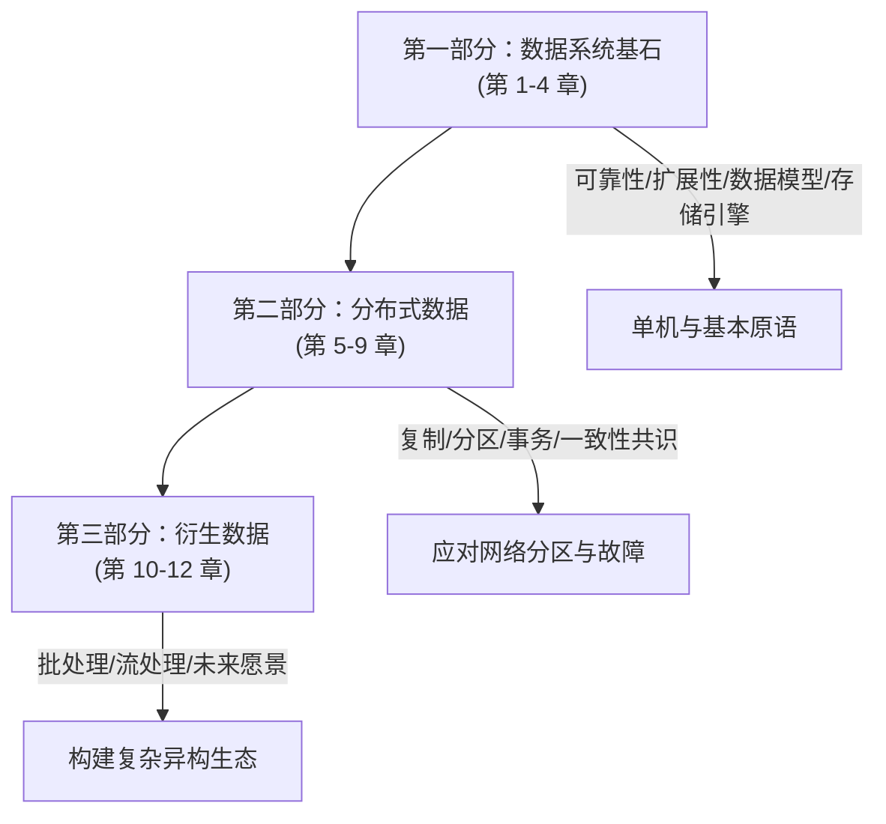

# 《设计数据密集型应用》导读与全书精要

> **一句话定位**：系统化解构现代分布式存储与数据处理系统的“九阳真经”，教你在各种工程取舍（CAP、一致性、延迟、吞吐）中做出理性的技术选型。

---

## 🗺️ 全书全景与思维导图 (Mindmap & Overview)

- 📊 **常驻思维导图**：[点击打开思维导图 (持续演进)](./mindmap.xmind)
- **知识主干架构图**：

---

## 🧭 导读建议与阅读路径 (Reading Guide)

* **极速通读（建议 1~2 周）**：
  - 重点阅读：[第 1 章](./ch01-可靠性可扩展性与可维护性.md)、第 5 章（复制）、第 7 章（事务）。
  - 核心关注：建立分布式系统的核心心智模型，弄懂 CAP 和隔离级别。
* **存储引擎攻坚者**：
  - 重点阅读：第 2 章（数据模型对比）与第 3 章（LSM-Tree vs B-Tree 存储引擎底层剖析）。
* **分布式一致性攻坚者**：
  - 重点研读：第 8 章（分布式系统的麻烦事）与第 9 章（一致性与共识）。

---

## 📑 章节直达索引与精粹 (Chapter Index)

| 章节编号 | 章节名称 | 核心一句话结论 | 状态 | 笔记链接 |
| :--- | :--- | :--- | :--- | :--- |
| 第 1 章 | 可靠性、可扩展性与可维护性 | 软件容错优于零故障硬件；负载与尾部延迟（P99）是度量可扩展性的核心标尺。 | ✅ 已完成 | [阅读笔记](./ch01-可靠性可扩展性与可维护性.md) |
| 第 2 章 | 数据模型与查询语言 | 数据模型塑造了思考方式；文档模型强于树状局部性，关系模型胜在多对多规范化。 | ✅ 已完成 | [阅读笔记](./ch02-数据模型与查询语言.md) |
| 第 3 章 | 存储与检索 | *(待开始)* | ⏳ 待开始 | - |

---

## ❓ 全书研讨与未决疑问库 (Questions & Inquiries Backlog)
> 本模块由 `note-archiver` 自动汇总自各章节的疑问与批判性反思，作为二轮复盘或实战验证的研究课题。

### 来自第 1 章：
- [ ] **疑问 1**：推特混合架构中，区分大V走拉模式的具体阈值到底是多少粉？对于超大V，普通用户拉取时间线时的缓存穿透与高并发聚合延迟在工程上如何优化？
- [ ] **疑问 2**：尾部延迟（Tail Latency）P99.9 与 P99 的取舍在真实 SLA 制定中如何与机器成本平衡？是否有必要为了 0.1% 的用户翻倍硬件投入？
- [ ] **疑问 3**：双写（Dual-write）场景下，如果没有强一致的分布式事务，使用变更数据捕获（CDC）和消息队列如何彻底杜绝并发乱序与竞态条件？

### 来自第 2 章：
- [ ] **疑问 4**：在现实的高并发微服务中，到底什么时候应该坚决从 PostgreSQL 迁移到 MongoDB？有没有明确的定量 QPS 或数据量级指标？
- [ ] **疑问 5**：Datalog 与 SPARQL 声明式查询在分布式执行引擎里的物理优化器实现差异是什么？

---

## 💡 终极思考与认知升级 (Synthesis & Retrospective)
* **核心认知转变**：从盲目相信“完美高可用”转变为“设计能应对不可靠组件的容错架构”。
* **最精彩的洞见**：*（阅读完后续章节持续沉淀）*
