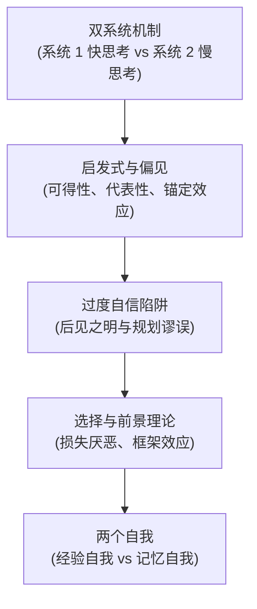

# 《思考，快与慢》导读与全书精要

> **一句话定位**：颠覆“理性人”神话的行为经济学开山之作，用双系统视角透视人类认知偏见的底层生理机制。

---

## 🗺️ 全书全景与思维导图 (Mindmap & Overview)

- 📊 **常驻思维导图**：[点击打开思维导图 (持续演进)](./mindmap.xmind)
- **知识主干架构图**：

---

## 🧭 导读建议与阅读路径 (Reading Guide)

* **极速核心通读（建议 1 周）**：
  - 重点阅读：[第 1 章](./ch01-系统1与系统2.md)、第 11 章（锚定效应）、第 26 章（前景理论）。
* **技术决策与管理者必读**：
  - 重点研读第三部分：过度自信与规划谬误，解决软件估算普遍严重超时的根本心理机制。

---

## 📑 章节直达索引与精粹 (Chapter Index)

| 章节编号 | 章节名称 | 核心一句话结论 | 状态 | 笔记链接 |
| :--- | :--- | :--- | :--- | :--- |
| 第 1 章 | 系统 1 与系统 2 | 快思考直觉主导日常反应，慢思考理性但极其懒惰，人类天生容易掉入认知偏差。 | ✅ 已完成 | [阅读笔记](./ch01-系统1与系统2.md) |
| 第 2 章 | 注意力与心力 | *(待开始)* | ⏳ 待开始 | - |

---

## ❓ 全书研讨与未决疑问库 (Questions & Inquiries Backlog)
> 本模块由 `note-archiver` 自动汇总自各章节的疑问与批判性反思，作为二轮复盘或实战验证的研究课题。

### 来自第 1 章：
- [ ] **疑问 1**：现代人在海量短视频与快节奏信息流轰炸下，系统 2 是否正在发生器质性的认知注意力退化？有无科学的刻意训练手段让系统 2 更高效地接管关键决策？
- [ ] **疑问 2**：在技术团队做架构评审（Design Review）时，很多资深工程师凭借直觉给出的方案本质是系统 1 的启发式模式匹配，如何通过制度化 Checklist 强制激活系统 2 介入？

---

## 💡 终极思考与认知升级 (Synthesis & Retrospective)
* **核心认知转变**：从相信“我是纯粹理性的决策者”转变为“对自己的直觉时刻保持警惕，用系统化的外部工具纠偏”。
