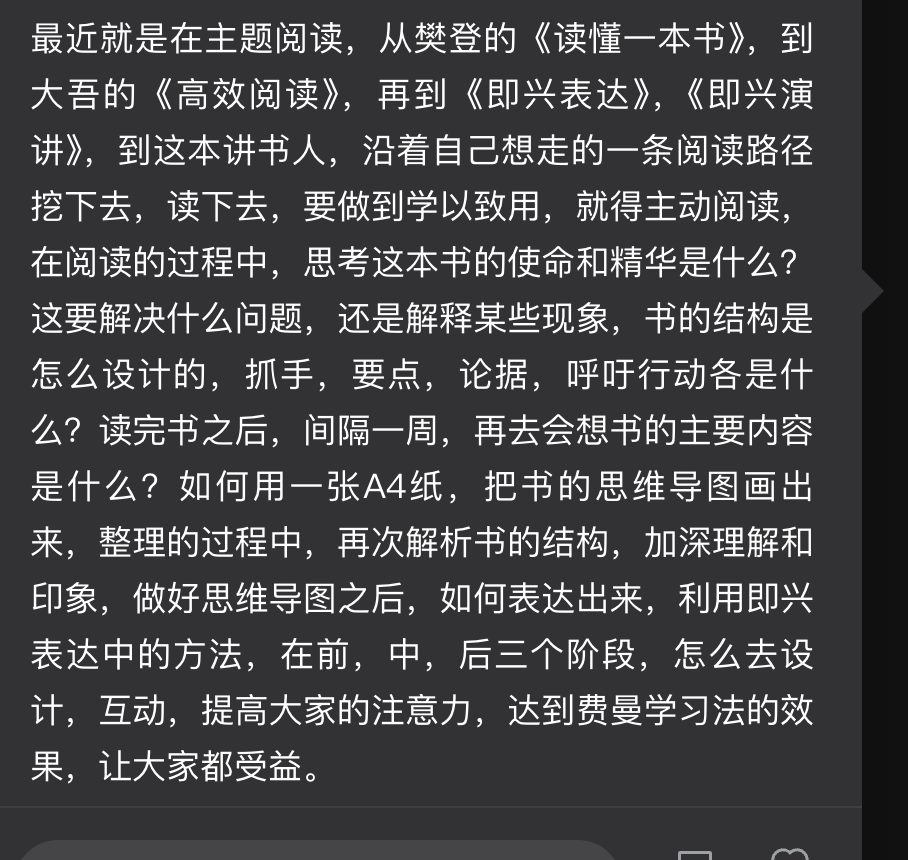
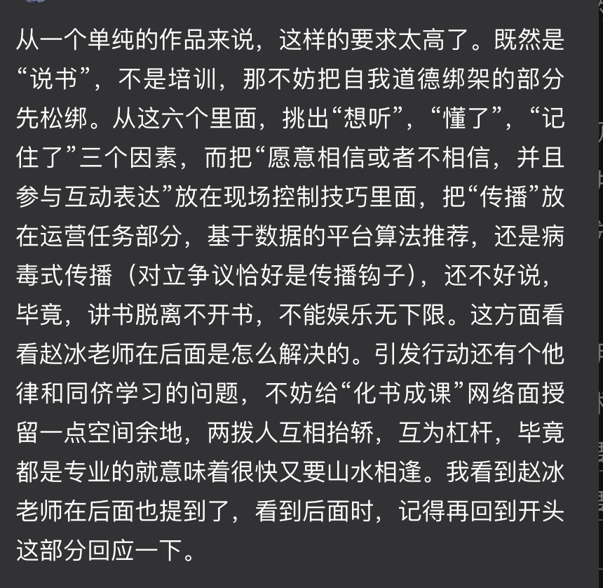
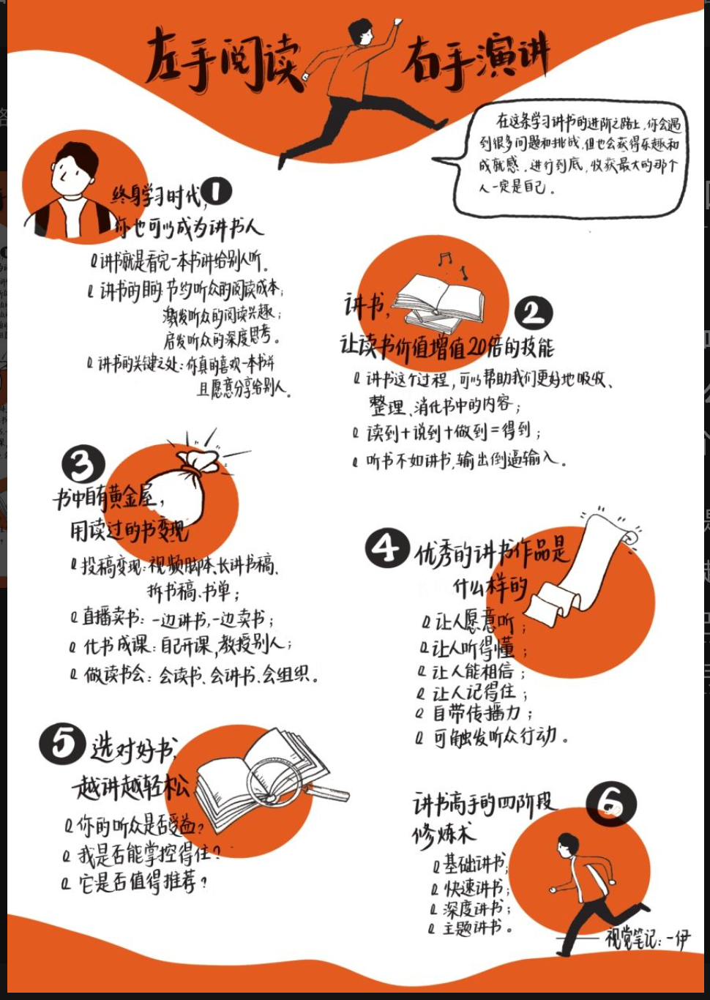

# 第 1 章 左手阅读，右手演讲

> "第二章的名字是左手阅读，右手演讲，让我想起来了金庸小说里的左右互搏——讲书 = 阅读（内功） + 演讲（外招）。"

---

## 🧭 导读与核心关切 (Chapter Orientation)

- **本章核心解决痛点**：什么是讲书？讲书与阅读、演讲的底层关系是什么？如何破除“必须是全知全能专家才能讲书”的心理门槛，使讲书成为读书增殖 20 倍的高效学习法？
- **承上启下**：承接前言抛出的“阅读四座大山”与未解悬念，本章正式定义了讲书的边界（不是培训，也不是复读），并提出通过讲书实现“读到 + 说到 + 做到 = 得到”的知行合一闭环。

---

## 💡 核心论点与批判性解构 (Key Takeaways & Critique)

### 1. 讲书的边界界定：重在分享，而非居高临下的培训
- **讲书不是培训**：培训重在让人掌握特定知识或技能，容易陷入居高临下的说教；讲书重在**分享个人消化后的观点**，核心是引发听众的主动思考。
- **讲书不是复读**：不是字句朗读（耳朵代替眼睛），而是将一本书经过**消化 $\rightarrow$ 提炼精华 $\rightarrow$ 结合个人感悟 $\rightarrow$ 口语化输出**。
- **讲书的目的与利他本质**：
  1. 节省听众阅读成本；
  2. 激发听众阅读兴趣；
  3. 启发听众深度思考。
  > 📌 **读者洞见**：读书笔记是写给自己的（向内求），但讲书是讲给听众听的（利他）。要讲好书，必须克服自我中心视角，切换为听众视角。

---

### 2. 阅读遇上演讲的三大化学反应
- **“燃烧”**：人天生爱分享，满足自我表达与成就感；
- **“萃取”**：将数十万字浓缩为几十分钟或几分钟。
  > 💡 **读者神级萃取法则（针对硬核大部头）**：
  > **“面对大部头，我们可以讲思路，而不讲具体怎么实现；可以讲实现的思路、架构选型与设计图的考量，而绝不要落入具体细节实现的代码死坑。”**
- **“爆炸”**：不同背景的人解读同一本书，碰撞出多维立体的观念火花。

---

### 3. 学习金字塔与费曼输出：说到才能真正得到
- **学习金字塔的层级**：听讲 (5%) $\rightarrow$ 阅读 (10%) $\rightarrow$ 视听 (20%) $\rightarrow$ 演示 (30%) $\rightarrow$ 讨论 (50%) $\rightarrow$ 实践 (75%) $\rightarrow$ **教授给他人 (90%)**。
- **金庸武侠喻体**：
  - 《倚天屠龙记》觉远和尚：空有一身九阳神功却不会武功招式（知道很多道理却不会分享表达）；
  - 《天龙八部》王语嫣：熟知天下各派武学却手无缚鸡之力（读了很多书却无法在实战中使用）。
- **内外兼修模型**：阅读是内功心法（输入），演讲是外功招式（输出）。
- **公式演进**：$得到 = 读到 + 说到 + 做到$。

---

### 4. 商业变现与三种讲书风格
- **讲书稿类型**：荐书稿 (200~300字)、长讲书稿 (6000~10000字)、拆书专栏稿 (每篇1500~2000字)。
- **讲书高手的四阶段**：基础讲书 $\rightarrow$ 快速讲书 $\rightarrow$ 深度讲书 $\rightarrow$ **主题讲书（化书为课）**。
- **三种讲书风格**：
  1. **搬运工**：初学者首选，有限篇幅内清晰准确表达原书意思；
  2. **大厨师**：精细加工，运用高阶表达技巧；
  3. **解梦人**：独到深刻，讲出常人未察觉的深意。

---

## ❓ 研读疑问与批判性反思 (Questions & Critical Reflections)

- [ ] **痛点 1（环境困境）：找不到倾听者怎么破？**
  > “费曼学习法说要用自己的话讲给别人听，但我一直找不到一个倾听的听众/小白鼠，没有听众怎么做输出闭环？”
  - *教练支架*：独处时的无受众费曼法——对着录音笔 60 秒自讲、对着 AI 讲、或以“写出给外行看的技术博客”作为虚拟听众。
- [ ] **痛点 2（案例批判）：4 个极端案例是真实普适还是心理暗示？**
  > 作者列举了 80 岁老人、9 岁小孩、古巴大学生、重度聋哑人四个案例，证明“人人都可以讲书”。
  - *批判反思*：这四个案例带有强烈的励志心理暗示。愿意分享是美德，但“讲出来的东西是否真的有价值、是否能保证准确不误导人”？尤其在技术和严肃领域，未读透就讲是否存在误人子弟的风险？
- [ ] **痛点 3（知行落差）：方法论偏虚，缺少具体操作工具**
  > “到现在的篇幅全在讲道，完全没有讲术的层面，也没有给出怎么写讲书稿的实践建议。”
  - *追踪伏笔*：紧密追踪作者从第 2 章开始的 15 种具体讲书工具，检验其能否给出可落地的实操指南。

---

## 🖼️ 核心图解索引 (Book Visuals)

- **图 1：化书为课与主题阅读**  
  
- **图 2：优秀讲书作品的 6 大特质**  
  
- **图 3：作者第 1 章全景思维脑图总结**  
  
