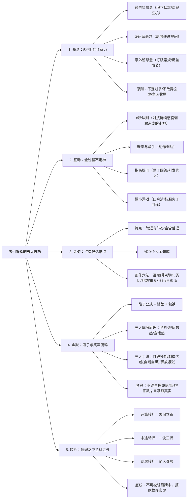

# 第 2 章 如何有效地吸引听众

## 🧭 导读与核心关切 (Chapter Orientation)

- **本章核心痛点**：听众注意力极其有限（黄金 8 秒），且极易在单向灌输中产生疲劳和注意力漂移。如何通过可操作的技巧在开篇迅速撕开认知缺口，并在过程中持续维持听众的专注与共鸣？
- **承上启下**：承接第 1 章对“讲书是利他分享、聚焦思路而非琐碎细节”的定义，本章开始深入具体战术层，探讨让表达“引人入胜”的五大抓手：**悬念、互动、金句、幽默与转折**。

---

## 🎯 4 维深度靶向探索复盘 (Socratic Probes & Reflections)

### 1. 【破除边界】“抓眼球的话术 vs 真正的认知悬念”

- **思考指引**：营销号的“震惊体”往往让人反感。作者给出的预告、设问、意外，本质是低级标题党，还是在脑中撕开“渴望被真相填补的认知缺口”？
- **读者洞察与回答**：
  > “震惊体是夸大内容，也是利用好奇心；而预告、设问、意外，本质是一些小互动来抓回读者的注意力。利用人类的好奇心，渴望知道真相。”
- **深度提炼**：廉价震惊体提供的是虚假情绪刺激，往往“悬念很大、内容极空”；真正的认知悬念必须**有始有终、给出扎实的解答闭环**，用真实的信息落差撬动求知欲。

---

### 2. 【机理深挖】硬核大部头如何做“意外”与“靴子”？

- **思考指引**：严肃技术专著（如《DDIA》）没有凶杀八卦，如何设计“未落地的靴子”？
- **读者洞察与回答**：
  > “意外就是不符合情理，应该可以通过一些不符合情理的技术案例，但是是真实的解决方案。”
- **深度提炼**：技术世界的顶级悬念往往隐藏在**“反直觉悖论”**之中——例如“单机加机器反而让分布式集群吞吐雪崩（惊群效应与脑裂）”、“加锁保障了安全却导致死锁宕机”。通过真实事故或极端反差作为“靴子”，能让硬核读者瞬间进入解谜状态。

---

### 3. 【现实痛点】“没有现实听众，‘互动技巧’对我有什么用？”

- **思考指引**：在独处、写博客或技术分享时，作者大篇幅讲的互动技巧还能发挥作用吗？
- **读者洞察与回答**：
  > “我的设想是通过评论区，或者博客可以多做一些文章出现不同的反应。我的疑问真实如此。”
- **深度提炼**：文字和异步视频不仅能互动，而且是“高密度的思维推演”。可以通过在正文中主动植入反问、自答、“此时你可能会问……”等修辞，主动预判读者的思维卡点，形成隐性思维共舞。

---

### 4. 【批判性挑刺】技巧会沦为套路吗？

- **思考指引**：这些技巧是否会喧宾夺主、稀释知识本身的硬核密度？
- **读者洞察与回答**：
  > “不会，这些控场可以让听众更好的吸收。”
- **深度提炼**：形式服务于实质。只要知识内核足够硬核，恰当的控场与降维包工能大幅降低听众的认知负载（Cognitive Load），让深奥原理真正穿透传播壁垒。

---

## 💡 核心论点与关键提炼 (Key Takeaways)

作者在本章提出了吸引听众的五大工具箱：

### 1. 悬念设计：撕开认知缺口

- **第二只靴子定律**：人的本能渴望完整闭环。悬念的本质是建立预期，让未解决的问题悬挂在空中。提出“未落地的鞋子”作为认知钩子，持续吸引听众注意力直到答案揭晓。
- **三大实操方式**：
  1. **预告**：如电影序章，在开头抛出震撼结果或终局预警。
  2. **设问**：像“龟兔赛跑”步步逼近核心命题，通过连续小问题牵引注意力。
  3. **意外**：颠覆认知常理的现象（“今天，妈妈死了。也许是昨天，我搞不清”）。
- **避坑守则**：悬念不是越多越好，过多会让人疲惫反感；必须有始有终，抛出的问题必须落地。

### 2. 互动设计：穿透 8 秒注意力瓶颈

- **痛点**：长时间单一感官刺激（平铺直叙的语音或文字）会导致大脑进入节能低频模式，引发走神或刷手机。
- **三层互动手段**：
  - 穿插微动作（举手、鼓掌、点头确认）；
  - 易于回答的具体提问（诱发思考与代入感）；
  - 规则简单的互动小环节。
- **核心心法**：一切手段皆服务于注意力回拉与认知同频，绝不做无意义的瞎折腾。

### 3. 金句设计：浓缩核心认知的“记忆钩子”

- **特征**：结构短小、节奏感强、富有洞见。
- **金句制造 6 大模型**：
  1. **否定法（非 A 而是 B）**：定义旧认知 A，推导出新认知 B，重构语序。
  2. **类比法（本体与喻体）**：“命运是套餐，不能单点”、“人生就像手里捧着一盏水……”。
  3. **押韵法**：降低大脑加工难度，形成听觉愉悦。
  4. **重复法 (Repetition)**：强调核心主旨，构建声势。
  5. **顶针法**：上句尾字为下句首字（AB -> BC），增强连贯性。
  6. **毒鸡汤法**：前半句立高调，后半句接骨感现实（如“世上无难事，只要肯放弃”）。

### 4. 幽默感：化解防备的高阶润滑剂

- **幽默公式**：$\text{段子} = \text{铺垫} + \text{包袱}$。
  - 铺垫陈述事实建立合理预期；
  - 包袱打破原有逻辑产生反差。
- **经典联想（星爷周星驰的打破预期）**：周星驰电影（如《少林足球》等）将“打破预期”运用到了化境——严肃正经的武侠大片铺垫，下一秒瞬间接上荒诞离谱的现实反差，产生无可替代的笑声。
- **发笑三大心理机制**：
  - **意外感**：打破预期（时空错位、夸张、故意曲解）；
  - **优越感**：贬低自己（自嘲、自黑、吐真槽），让听众产生优越与放松；
  - **宣泄感**：制造紧张后突然释放（先抑后扬、假意冒犯）。
- **底线原则**：自嘲须发自内心接受，切勿过度自伤；严肃场合慎用，不搞人身攻击与低俗话题。

### 5. 转折设计：故事产生于对预期的违反

- 杰罗姆·布鲁纳：“故事产生于对预期的违反。”
- **转折三用法**：
  - 开篇破旧立新（颠覆旧观念）；
  - 过程一波三折（方案 A 失败 -> 尝试方案 B 遇阻 -> 领悟方案 C）；
  - 结尾耐人寻味（留白与余音）。

---

## 🖼️ 视觉导图复盘 (Visual Notes)

---

## 💬 深度研讨与思维碰撞留痕 (Socratic Q&A Log)

> 💡 **机制说明**：记录读者在精读本章时亲笔提出的原生疑问、痛点反思，以及与 AI 教练的多轮深度碰撞与解决方案。支持随时在此追加新的追问与反思，保持认知持续演进。

### ❓ Q1 [QA-PRESENTER-CH02-01]：人的注意力只有 8 秒，视频讲书/录播时如何使用互动技巧？
- **资产元数据**：`状态: in_progress` | `依据类型: [🤖 AI 推演/工程实践]` | `标签: #注意力机制 #视频互动`
- **读者原问**：
  > “人的注意力只有 8 秒，长时间持续不变的感官刺激容易让人走神。注意如此短，怎么吸引听众注意力？视频讲书时，怎么使用这种技巧呢？”
- **痛点本质**：作者给出的“鼓掌举手、指名提问某人、现场小游戏”全是在线下强迫物理场域下生效的。在单向录制的视频/录播场景中，观众隔着屏幕，无法实时强制双向互动。
- **研讨方案（异步交互与心智拉扯）**：
  1. **画面切片（重置 8 秒视觉时钟）**：人眼连续注视同一静态画面超过 8 秒会自动调低敏锐度。通过每 6~8 秒的景别微切、关键大字卡弹出、局部放大、类比梗图，强制重置视觉中枢注意力。
  2. **前置代入（把指名提问转化为对号入座）**：直接对屏幕预判读者特征（“*屏幕前经常买书却一本读不完的朋友，我知道你书架上至少有 3 本塑封都没拆，对不对？*”），激活“他在跟我说话”的触电感。
  3. **低阻力二选一（动作互动）**：在关键节点抛出非黑即白的抉择（“*如果你是主角，你会冒险辞职还是原地苟着？辞职扣 1，留下扣 2*”），用低成本动作强行拉回走神，同时触发平台算法推流。
- **对抗性检视 (反例与边界)**：画面切片切忌过度碎片化（如低于 2 秒的快闪），否则会引发认知超载，削弱深度技术内容的消化。
- **后续迭代/实操验证**：在录制 60 秒微讲书视频时验证画面切片频次对完播率的影响。

---

### ❓ Q2 [QA-PRESENTER-CH02-02]：“幽默是关于真相与痛苦的”怎么理解？普通人怎么培养这种原创幽默能力？
- **资产元数据**：`状态: in_progress` | `依据类型: [📖 原书事实 + 🤖 AI 推演]` | `标签: #幽默感 #自嘲 #认知真相`
- **读者原问**：
  > “作者说好的幽默是有趣、智慧、原创（幽默是关于真相+痛苦的）。怎么理解呢？
  > 1. 找出不同的视角去看待一件事；2. 幽默是关于真相+痛苦的；3. 原创。
  > 怎么培养自己的这种能力呢？有没有什么好的建议？”
- **痛点本质**：作者给出的定义很高级，但缺乏从 0 到 1 的认知拆解与可复现训练步骤。
- **研讨方案（第一性原理剖析与 3 步刻意练习法）**：
  - **核心理解**：
    - **真相与痛苦**：喜剧的内核是悲剧。生活中充满大家心知肚明却不敢当众承认的尴尬、狼狈或虚荣；谁敢第一个把令人难堪的“骨感真相”坦诚剥开，谁就掌握了幽默。
    - **有趣与智慧**：换一个别人意料之外的视角看痛点（不是抱怨，而是洞察）。
    - **原创**：从自己真实的尴尬经历中提取反差，而非复读网络烂梗。
  - **3 步刻意练习法**：
    1. **建立“尴尬与翻车日志”**：每天随手记下自己今天最狼狈或愚蠢的一个瞬间，沉淀 24 小时后就是最好的包袱原料。
    2. **套用铺垫与反差公式**：$\text{段子} = \text{铺垫（正经陈述常理）} + \text{包袱（揭示荒唐真相）}$（*例：“我本以为买个阅读器能让我一年多读 50 本书，后来发现它最核心的性能是压泡面极其保温”*）。
    3. **自嘲降维（安全边界）**：新手绝不拿他人开刀，只嘲讽自己的身材、拖延和愚蠢决策。既能通过自贬制造听众的优越感，又绝不会产生攻击性与反感。
- **对抗性检视 (反例与边界)**：在极度正式、安全事故责任定损等严肃场合，滥用幽默会被解读为轻浮与缺乏职业素养。
- **后续迭代/实操验证**：在日常笔记中建立个人翻车档案，尝试每周写出 1 个自嘲小段子。

---

### ❓ Q3 [QA-PRESENTER-CH02-03]：没有现实听众时，文字博客如何模拟互动？“评论区预设与多反应文章”设想可行吗？
- **资产元数据**：`状态: verified` | `依据类型: [💡 读者洞察 + 🤖 AI 验证]` | `标签: #异步互动 #博文架构 #读者心理`
- **读者原问**：
  > “在现实中我根本找不到倾听者和小白鼠，在一个人独处、自言自语或写技术博客时，这些互动技巧还能发挥作用吗？我的设想是通过评论区，或者博客可以多做一些文章出现不同的反应。我的疑问真实如此。”
- **痛点本质**：单人文字输出极其容易变成自说自话的“说明书”，读者读着枯燥，作者也得不到反馈。
- **研讨方案（验证并深化读者的设想）**：
  - **读者设想完全击中要害**！文字不仅能互动，而且是“高密度的心理推演博弈”：
  1. **读者假想敌视角（设问自答）**：在写完一个反常识观点后，立刻把读者心里准备反驳的话以引用块形式写出来（*“看到这里，你大概会在心里冷笑：‘这方案上线绝对死锁’！别急，看下一行日志……”*）。读者会产生“作者懂我心理”的强烈共鸣。
  2. **决策分支卡片（让读者做选择）**：在方案十字路口提供条件分支（*“如果你追求高吞吐，跳过本节看方案 A；如果你是金融交易不能容忍 1ms 延迟，请看方案 B”*），把被动阅读转化为主动探索。
  3. **评论区“留靶子”（放弃无效客套）**：结尾绝不写“欢迎交流”，而是抛出极具争议的具体两难抉择（*“如果是你，你会为了省一半服务器成本接受数据有 2 秒延迟吗？在评论区留下你的决断”*），提供极低门槛的表达动机。
- **后续迭代/实操验证**：在下一篇博文中刻意埋设 2 处假想敌反问与 1 个评论区取舍靶子。

---

### ❓ Q4 [QA-PRESENTER-CH02-04]：如何脱离具体书目视角，系统化实践作者的整套吸引力模型？
- **资产元数据**：`状态: in_progress` | `依据类型: [🤖 综合方法论]` | `标签: #实战SOP #讲书人五星模型`
- **研讨沉淀**：
  - **输入端**：按 6 大公式建立 [灵感金句矩阵](../../topics/quotes-matrix.md)，建立尴尬自嘲反差库；
  - **创作端**：采用“五星装配法”（开篇装悬念破旧、中途装 8 秒互动与转折、节点装金句幽默、结尾装靴子落地）；
  - **训练端**：使用 3 分钟录音切片测试法，对照 5 维检视清单盲测自纠。
  - **实战打卡**：前往 [task01-ch02-five-weapons-card.md](../../learning-tasks/presenter-drills/task01-ch02-five-weapons-card.md) 进行 250 字微讲稿刻意练习。

---

## 📌 精彩摘录与个人金句库 (Excerpts & Annotations)

> 💡 **全局金句矩阵联动**：本章提炼的定桩金句与经典摘抄已同步收录至全局 [💎 灵感金句与认知索引矩阵 (topics/quotes-matrix.md)](../../topics/quotes-matrix.md)。

> “所谓金句，就是那些像金子一样宝贵的、有价值的、有意义的句子。这样的句子通常具备积极正面、有能量、引人思考等特质。”

- **批注**：金句不仅是修辞，更是高度压缩的认知胶囊。行动永远是第一要素。

> “如果你不能按照想要的样子去活，那么总有一天你会按照活的样子去想。”

- **金句收集**：反向警醒，认知必须通过行动重塑，否则就会被现状同化。

> “求知若饥，虚心若愚（Stay hungry, stay foolish）。”

- **金句收集**：极致经典的否定与对比。

> “人生就像手里捧着一盏水，看着它一点点漏掉，我们唯一能做的就是让它漏得慢一点。”

- **金句收集**：精准的类比法典范。

---

## 🛠 行动项与落地实践 (Actionable Insights)

- [x] **整理本章五大技巧思维脑图**：已将手绘视觉笔记归档入 assets 并关联到笔记中。
- [ ] **完成实战打卡任务 01**：[👉 五星吸引力微讲书卡片刻意练习 (MVP)](../../learning-tasks/presenter-drills/task01-ch02-five-weapons-card.md)（装配五大武器写出 250 字卡片）。
- [ ] **建立个人金句与段子库**：在日常研读与工作实践中，记录有深度的工程金句与“痛点自嘲”段子。
