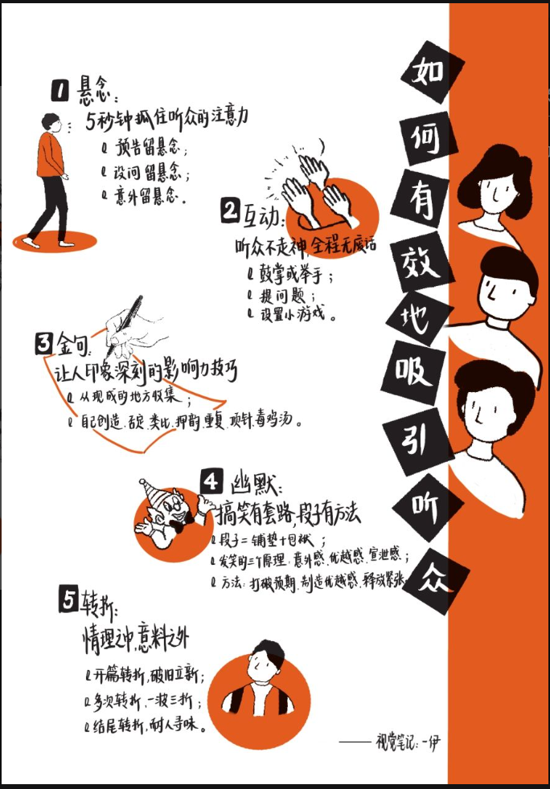

# 第 2 章 如何有效地吸引听众

## 🧭 导读与核心关切 (Chapter Orientation)

- **本章核心痛点**：听众注意力极其有限（黄金 8 秒），且极易在单向灌输中产生疲劳和注意力漂移。如何通过可操作的技巧在开篇迅速撕开认知缺口，并在过程中持续维持听众的专注与共鸣？
- **承上启下**：承接第 1 章对“讲书是利他分享、聚焦思路而非琐碎细节”的定义，本章开始深入具体战术层，探讨让表达“引人入胜”的五大抓手：**悬念、互动、金句、幽默与转折**。

---

## 🎯 4 维深度靶向探索复盘 (Socratic Probes & Reflections)

### 1. 【破除边界】“抓眼球的话术 vs 真正的认知悬念”
- **思考指引**：营销号的“震惊体”往往让人反感。作者给出的预告、设问、意外，本质是低级标题党，还是在脑中撕开“渴望被真相填补的认知缺口”？
- **读者洞察与回答**：
  > “震惊体是夸大内容，也是利用好奇心；而预告、设问、意外，本质是一些小互动来抓回读者的注意力。利用人类的好奇心，渴望知道真相。”
- **深度提炼**：廉价震惊体提供的是虚假情绪刺激，往往“悬念很大、内容极空”；真正的认知悬念必须**有始有终、给出扎实的解答闭环**，用真实的信息落差撬动求知欲。

---

### 2. 【机理深挖】硬核大部头如何做“意外”与“靴子”？
- **思考指引**：严肃技术专著（如《DDIA》）没有凶杀八卦，如何设计“未落地的靴子”？
- **读者洞察与回答**：
  > “意外就是不符合情理，应该可以通过一些不符合情理的技术案例，但是是真实的解决方案。”
- **深度提炼**：技术世界的顶级悬念往往隐藏在**“反直觉悖论”**之中——例如“单机加机器反而让分布式集群吞吐雪崩（惊群效应与脑裂）”、“加锁保障了安全却导致死锁宕机”。通过真实事故或极端反差作为“靴子”，能让硬核读者瞬间进入解谜状态。

---

### 3. 【现实痛点】“没有现实听众，‘互动技巧’对我有什么用？”
- **思考指引**：在独处、写博客或技术分享时，作者大篇幅讲的互动技巧还能发挥作用吗？
- **读者洞察与回答**：
  > “我的设想是通过评论区，或者博客可以多做一些文章出现不同的反应。我的疑问真实如此。”
- **深度提炼**：文字和异步视频不仅能互动，而且是“高密度的思维推演”。可以通过在正文中主动植入反问、自答、“此时你可能会问……”等修辞，主动预判读者的思维卡点，形成隐性思维共舞。

---

### 4. 【批判性挑刺】技巧会沦为套路吗？
- **思考指引**：这些技巧是否会喧宾夺主、稀释知识本身的硬核密度？
- **读者洞察与回答**：
  > “不会，这些控场可以让听众更好的吸收。”
- **深度提炼**：形式服务于实质。只要知识内核足够硬核，恰当的控场与降维包工能大幅降低听众的认知负载（Cognitive Load），让深奥原理真正穿透传播壁垒。

---

## 💡 核心论点与关键提炼 (Key Takeaways)

作者在本章提出了吸引听众的五大工具箱：

```mermaid
mindmap
  root((吸引听众的五大技巧))
    1. 悬念：5秒抓住注意力
      预告留悬念 (埋下伏笔/暗藏玄机)
      设问留悬念 (层层递进提问)
      意外留悬念 (打破常规/反差情节)
      原则：不宜过多/不故弄玄虚/务必收尾
    2. 互动：全过程不走神
      8秒法则 (对抗持续感官刺激造成的走神)
      鼓掌与举手 (动作调动)
      指名提问 (易于回答/引发代入)
      微小游戏 (口令清晰/紧扣目标)
    3. 金句：打造记忆锚点
      特点：简短有节奏/富含哲理
      建立个人金句库
      创作六法：否定(非A即B)/类比/押韵/重复/顶针/毒鸡汤
    4. 幽默：段子与笑声密码
      段子公式 = 铺垫 + 包袱
      三大底层原理：意外感/优越感/宣泄感
      三大手法：打破预期/制造优越(自嘲自黑)/释放紧张
      禁忌：不碰生理缺陷/低俗/宗教；自嘲须真实
    5. 转折：情理之中意料之外
      开篇转折：破旧立新
      中途转折：一波三折
      结尾转折：耐人寻味
      底线：不可被轻易猜中，拒绝故弄玄虚
```

### 1. 悬念设计：撕开认知缺口
- **第二只靴子定律**：人的本能渴望完整闭环。悬念的本质是建立预期，让未解决的问题悬挂在空中。
- **三大实操方式**：
  1. **预告**：如电影序章，在开头抛出震撼结果或终局预警。
  2. **设问**：像“龟兔赛跑”步步逼近核心命题，通过连续小问题牵引注意力。
  3. **意外**：颠覆认知常理的现象（“今天，妈妈死了。也许是昨天，我搞不清”）。
- **避坑守则**：悬念不是越多越好，过多会让人疲惫反感；必须有始有终，抛出的问题必须落地。

### 2. 互动设计：穿透 8 秒注意力瓶颈
- **痛点**：长时间单一感官刺激（平铺直叙的语音或文字）会导致大脑进入节能低频模式，引发走神或刷手机。
- **三层互动手段**：
  - 穿插微动作（举手、鼓掌、点头确认）；
  - 易于回答的具体提问（诱发思考与代入感）；
  - 规则简单的互动小环节。
- **核心心法**：一切手段皆服务于注意力回拉与认知同频，绝不做无意义的瞎折腾。

### 3. 金句设计：浓缩核心认知的“记忆钩子”
- **特征**：结构短小、节奏感强、富有洞见。
- **金句制造 6 大模型**：
  1. **否定法（非 A 而是 B）**：定义旧认知 A，推导出新认知 B，重构语序。
  2. **类比法（本体与喻体）**：“命运是套餐，不能单点”、“人生就像手里捧着一盏水……”。
  3. **押韵法**：降低大脑加工难度，形成听觉愉悦。
  4. **重复法 (Repetition)**：强调核心主旨，构建声势。
  5. **顶针法**：上句尾字为下句首字（AB -> BC），增强连贯性。
  6. **毒鸡汤法**：前半句立高调，后半句接骨感现实（如“世上无难事，只要肯放弃”）。

### 4. 幽默感：化解防备的高阶润滑剂
- **幽默公式**：$\text{段子} = \text{铺垫} + \text{包袱}$。
  - 铺垫陈述事实建立合理预期；
  - 包袱打破原有逻辑产生反差。
- **发笑三大心理机制**：
  - **意外感**：打破预期（时空错位、夸张、故意曲解）；
  - **优越感**：贬低自己（自嘲、自黑、吐真槽），让听众产生优越与放松；
  - **宣泄感**：制造紧张后突然释放（先抑后扬、假意冒犯）。
- **底线原则**：自嘲须发自内心接受，切勿过度自伤；严肃场合慎用，不搞人身攻击与低俗话题。

### 5. 转折设计：故事产生于对预期的违反
- 杰罗姆·布鲁纳：“故事产生于对预期的违反。”
- **转折三用法**：
  - 开篇破旧立新（颠覆旧观念）；
  - 过程一波三折（方案 A 失败 -> 尝试方案 B 遇阻 -> 领悟方案 C）；
  - 结尾耐人寻味（留白与余音）。

---

## 🖼️ 视觉导图复盘 (Visual Notes)



---

## ❓ 研读疑问与批判性思考 (Questions & Inquiries)

- [ ] **疑问 1（实操落地困惑）**：作者给出了大量具体技巧，但在日常技术博文、架构宣讲或单人录制视频时，究竟该如何系统化地实践与落地？
- [ ] **疑问 2（教练提问盲区复盘）**：教练预置的 4 维提问主要聚焦在“悬念与互动”，未能全面覆盖“金句、幽默、转折”三大武器，如何补齐并优化提问覆盖度？
- [ ] **疑问 3（视频讲书注意力维持）**：人在视频环境中的注意力只有 8 秒，如何把线下的互动（举手、提问）转化为线上单向视频中的注意力锚点？
- [ ] **疑问 4（幽默与原创能力培养）**：好的幽默是“有趣、智慧、原创（关乎真相与痛苦）”，技术人该如何从零培养这种敏锐的洞察与幽默感？
- [ ] **疑问 5（单人写作的互动设计）**：在缺乏外部听众的技术博客中，如何利用排版、自问自答和预判读者反驳来模拟高频互动？

---

## 📌 精彩摘录与个人金句库 (Excerpts & Annotations)

> “所谓金句，就是那些像金子一样宝贵的、有价值的、有意义的句子。这样的句子通常具备积极正面、有能量、引人思考等特质。”
- **批注**：金句不仅是修辞，更是高度压缩的认知胶囊。行动永远是第一要素。

> “如果你不能按照想要的样子去活，那么总有一天你会按照活的样子去想。”
- **金句收集**：反向警醒，认知必须通过行动重塑，否则就会被现状同化。

> “求知若饥，虚心若愚（Stay hungry, stay foolish）。”
- **金句收集**：极致经典的否定与对比。

> “人生就像手里捧着一盏水，看着它一点点漏掉，我们唯一能做的就是让它漏得慢一点。”
- **金句收集**：精准的类比法典范。

---

## 🛠 行动项与落地实践 (Actionable Insights)

- [x] **整理本章五大技巧思维脑图**：已将手绘视觉笔记归档入 assets 并关联到笔记中。
- [ ] **实战迁移测试（技术博文）**：选一个硬核技术主题（如“Redis 分布式锁踩坑记”），尝试用“悬念（意外案发现场）+ 设问自答（互动）+ 类比金句 + 幽默自嘲”重构引言。
- [ ] **建立个人金句与段子库**：在日常研读《DDIA》和工作实践中，记录有深度的工程金句与“痛点自嘲”段子。
