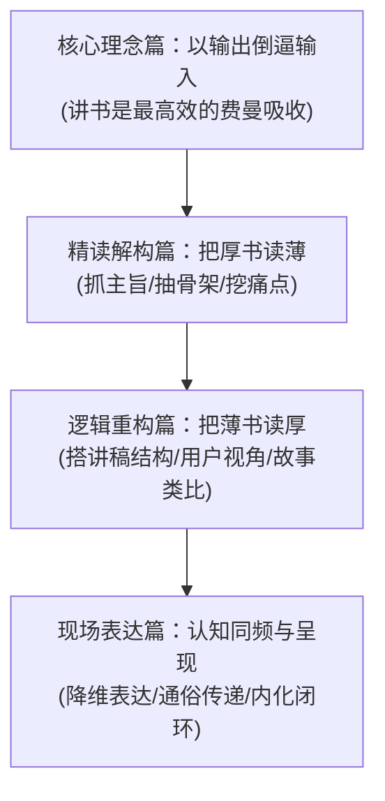

# 《成为讲书人：阅读和表达的个人精进法》导读与全书精要

> **一句话定位**：以“讲书输出”倒逼深度吸收的个人认知操作系统，教你如何把一本晦涩庞杂的大部头拆出硬核骨架，并用通俗清晰的逻辑重构成自己的知识资产。

---

## 🎯 我的专属研读目标 (Personal Objectives)

1. **认知重塑**：不为“做网红讲书”而读，纯粹借用“讲书人”的解构与重构心智，彻底征服像《DDIA》、《CSAPP》等硬核技术专著。
2. **能力双修**：
   - **拆书力（解构）**：如何在几百页专业术语中，快速刺穿表象，揪出作者的根本立论与推导骨架。
   - **讲书力（重构）**：如何将抽象难懂的系统架构与原理，用“痛点引入 - 核心机制 - 现实类比”重构成一个流畅的逻辑链条。

---

## 🗺️ 全书全景与思维导图 (Mindmap & Overview)

- 📊 **常驻思维导图**：[点击打开思维导图 (持续演进)](./mindmap.xmind)
- **知识主干架构图**：

---

## 🧭 导读建议与阅读路径 (Reading Guide)

* **第一阶段：攻坚“拆书力”（推荐重点精读）**：
  - 重点聚焦：全书关于**“结构化拆书”**与**“核心知识点萃取”**的章节。
  - 靶向输出：读完这几章后，直接拿《设计数据密集型应用》作为实验对象，测试能否拆出 3 层以内的核心逻辑骨架。
* **第二阶段：攻坚“讲书力”（逻辑重构）**：
  - 重点聚焦：讲书稿的搭建模型（如何设计引人入胜的“问题坡道”，如何把复杂算法或原理用生动类比呈现）。

---

## 📑 章节直达索引与精粹 (Chapter Index)

| 章节编号 | 章节名称 | 核心一句话结论 | 状态 | 笔记链接 |
| :--- | :--- | :--- | :--- | :--- |
| 第 1 章 | *(待开始)* | - | ⏳ 待开始 | - |

---

## 🧭 教练阶梯式思考罗盘 (Evolving Socratic Compass)
> 动态进化机制：随着章节的推进，AI 在每次归档后在此抛出 1~2 个针对下一阶段的深度思考题，作为进入下一章的认知支架。

### 阶段 0：读前透视与前言研读
- [x] **思考题 1**：作者想通过书名传递什么？（已明确：这是一本将讲书作为个人阅读与表达精进的实用方法论专著）。
- [ ] **思考题 2（前言待解）**：传统阅读导致“记不住、用不上”的致命死穴究竟是什么？讲书机制是如何在认知神经层面破解这个死穴的？

---

## ❓ 读者研读与未决疑问库 (Questions & Inquiries Backlog)
> 随着阅读深入，在草稿中记录的思考题将由 `note-archiver` 自动提取同步至此。

- [ ] **初始化核心疑问**：在面对纯理论、高数学/技术密度的专著时，如何界定“通俗化讲书”与“过度简化导致知识失真”的微妙平衡点？
- [ ] **实践检验**：如何将赵冰老师的讲书稿模型（如“破冰-提问-解密-升华”），无缝移植到技术团队的架构评审与内部分享中？

---

## 💡 终极思考与认知升级 (Synthesis & Retrospective)
* **核心认知转变**：从“被动吸收信息的读者”转变为“具备二次重构能力的知识解构者”。
