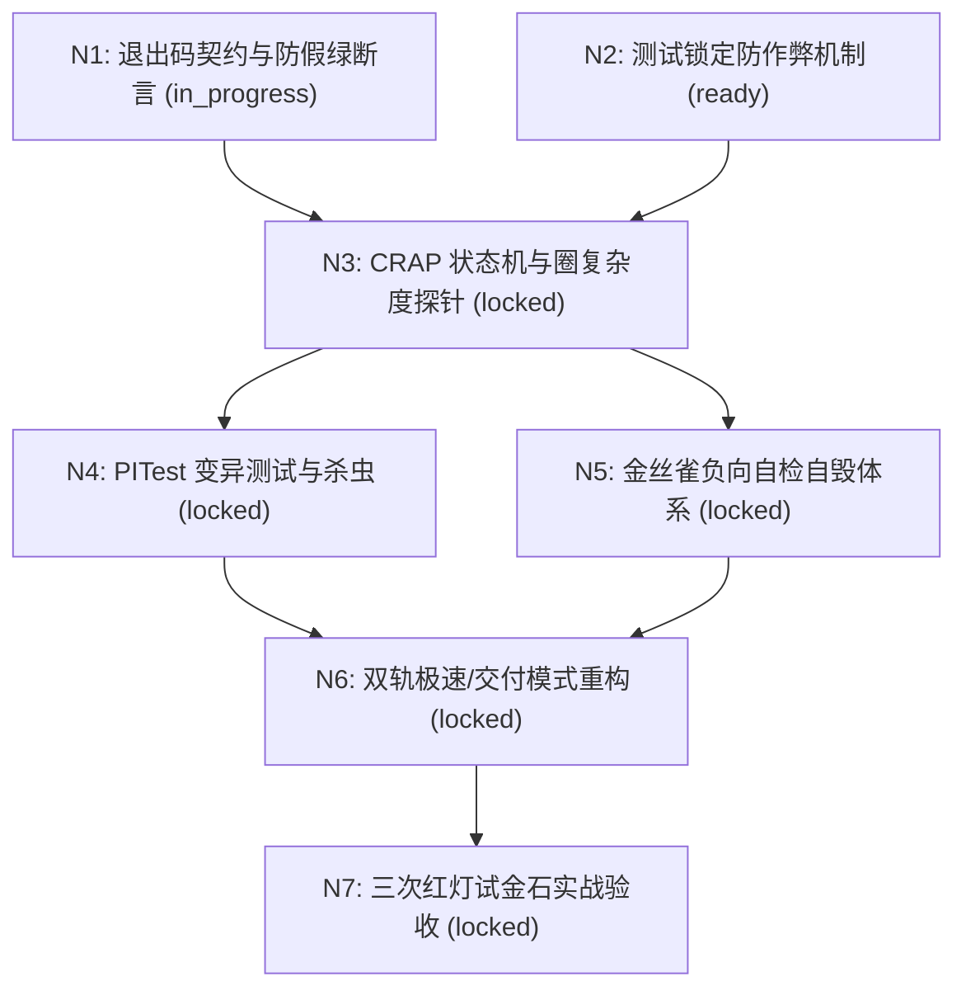

# 🛡️ Clean Architecture Harness 实战任务库

> 基于 Uncle Bob 软件质量工程哲学，从零构建跨平台双轨代码质量门禁，驱动 AI 完成端到端自愈交付。

---

## 📌 当前状态总览

- **目标主题**: Uncle Bob 质量门禁体系与 AI 协同实战
- **终极交付**: 双轨门禁引擎 + AI 3次红灯自愈试金石签字交付
- **状态机**: [`./study-state.yaml`](./study-state.yaml)
- **理论参考专论**: [`../../topics/clean-architecture-harness.md`](../../topics/clean-architecture-harness.md)
- **门禁执行调度器**: [`../../scripts/verify-harness.sh`](../../scripts/verify-harness.sh)

---

## 🗺️ 最小骨干 DAG 拓扑

