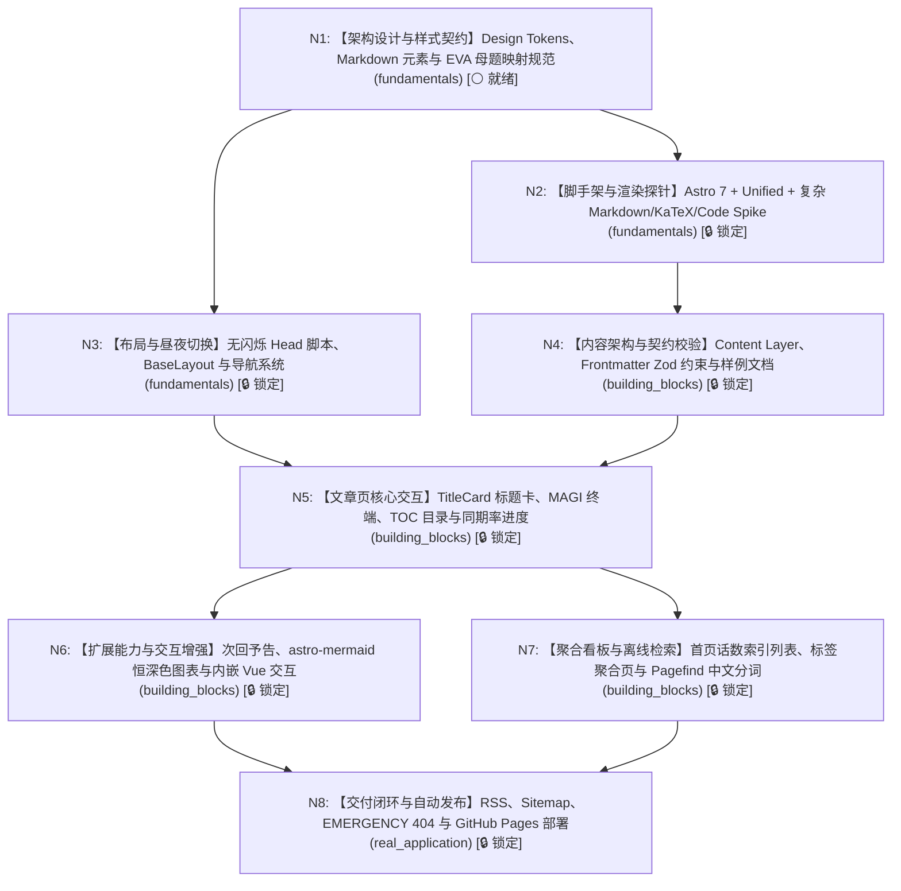

# EVA 风格个人技术博客实战 (eva-blog)

> **定位**：Astro 7 + EVA 战术控制台极客风格的纯静态个人技术博客。  
> **状态机**：[`study-state.yaml`](./study-state.yaml)  
> **设计原件**：[`design/mockup.html`](./design/mockup.html)  
> **架构设计**：[`ARCHITECTURE.md`](./ARCHITECTURE.md)  
> **驱动引擎**：`python3 scripts/mastery_state.py status`

---

## 1. 终极交付目标 (Final Goal)

在 `learning-tasks/eva-blog/` 下手写交付基于 Astro 7 的 EVA 战术终端风格个人技术博客，具备昼夜翻面、MAGI 深色代码与图表面板、同期率进度、Pagefind 离线检索与 GitHub Actions 自动发布能力。

---

## 2. 剪枝清单 (Explicit Cut-list)

- ❌ **本期明确跳过自建后端服务、登录认证与数据库体系**：坚持纯静态站点。
- ❌ **本期明确跳过阅读量、点赞统计等动态数据打点**：无外部接口依赖。
- ❌ **本期明确跳过 Tailwind 等原子类 CSS 框架**：恪守纯原生 CSS 变量系统。
- ❌ **本期明确跳过商业字体 Matisse EB**：全站标题卡统一采用开源免费的思源宋体 Heavy/Black。
- ❌ **本期明确跳过自建评论管理系统**：评论完全委托给 Giscus (GitHub Discussions)。

---

## 3. DAG 拓扑与执行状态

---

## 4. 任务清单总览

| 节点 | 阶段 | 难度 | 前置 | 核心交付标准 | 状态 |
|---|---|---|---|---|---|
| **N1** | fundamentals | medium | - | 产出《EVA 博客样式与渲染架构规范文档》，定死昼夜 CSS Token 与 Markdown 映射表 | ⚪ 就绪 |
| **N2** | fundamentals | high | N1 | Astro 7 骨架与 Unified 处理器验证，KaTeX/代码块/Alert 探针页 `pnpm build` 退出码 0 | 🔒 锁定 |
| **N3** | fundamentals | medium | N1 | BaseLayout 与 ThemeToggle，首屏防闪烁脚本，全站昼夜平滑翻面 | 🔒 锁定 |
| **N4** | building_blocks | medium | N2 | `src/content.config.ts` Content Layer 与 Zod 校验，字段违规精准报错拦截 | 🔒 锁定 |
| **N5** | building_blocks | high | N3, N4 | 极粗宋体标题卡、TOC 吸顶滚动联动、同期率百分比与进度线同步更新 | 🔒 锁定 |
| **N6** | building_blocks | high | N5 | 日夜模式下恒深色 Mermaid 渲染、正文内嵌响应式 Vue 控件、次回予告联结 | 🔒 锁定 |
| **N7** | building_blocks | medium | N5 | 首页倒序话数索引、标签聚合页、Pagefind 中文分词毫秒级快速全文搜索 | 🔒 锁定 |
| **N8** | real_application | medium | N6, N7 | RSS/Sitemap/斜纹 404，GitHub Actions 自动化构建部署至 GitHub Pages | 🔒 锁定 |
