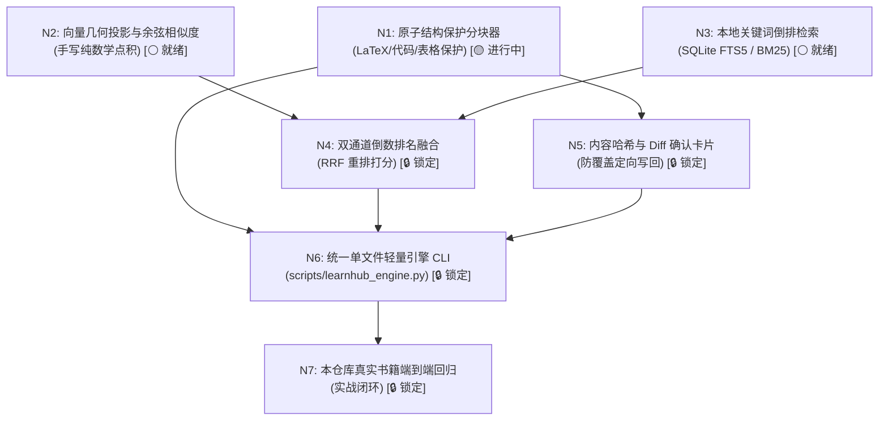

# LearnHub 核心引擎轻量造轮子实战 (learnhub-engine)

> **定位**：零重型依赖、极简自包含的 LearnHub 核心算法与引擎实现。  
> **状态机**：[`study-state.yaml`](./study-state.yaml)  
> **开发语言**：Python 3 (纯标准库，零外部中间件)

---

## 1. 终极交付目标 (Final Goal)

在 `scripts/learnhub_engine.py` 中交付一套完整的核心引擎轮子，包含三大核心能力：
1. **Markdown 原子结构保护分块器 (Structural Chunker)**：保护多行 LaTeX 公式、代码围栏与表格不被物理截断；
2. **本地轻量向量与关键词 RRF 检索器 (Hybrid Retriever)**：结合词法倒排与纯数学余弦相似度，利用倒数排名融合算法（RRF）重排；
3. **确定性定向编辑与 Diff 确认工具 (Targeted Note Edit)**：基于 SHA-256 内容哈希校验基准，防止并发覆盖。

---

## 2. 剪枝清单 (Explicit Cut-list)

- ❌ **绝不引入外部重型数据库**：跳过 MySQL 8、Milvus 向量集群、Redis，全部使用纯文件与本地 SQLite。
- ❌ **绝不引入臃肿框架**：跳过 Spring Boot、LangChain、LlamaIndex 黑盒框架，完全手写核心控制循环。
- ❌ **绝不涉足前端 UI 页面**：跳过 Vue 3 / Tiptap 编辑器界面，全部以 CLI、JSON 和标准 Unified Diff 文本为可观测交付物。
- ❌ **绝不自训模型**：跳过模型微调，直接对接标准 API 或 Ollama 本地轻量 Embedding 提取向量。

---

## 3. DAG 拓扑与执行状态



---

## 4. 实战与验证命令

```bash
# 1. 运行 N1 节点 TDD 红灯测试
python3 learning-tasks/learnhub-engine/test_chunker.py

# 2. 状态机推进与看板透视
python3 scripts/mastery_state.py status --file learning-tasks/learnhub-engine/study-state.yaml

# 3. 门禁通关判定 (N1 绿灯后执行)
python3 scripts/mastery_state.py pass N1 --file learning-tasks/learnhub-engine/study-state.yaml
```
