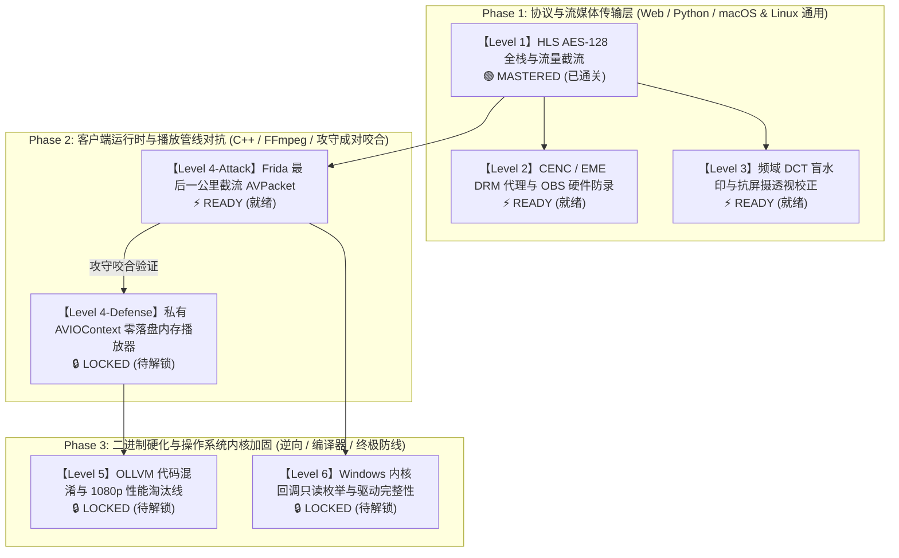

# 视频加密与防盗录攻防实战任务库 (video-security-lab)

本任务库整合了底层音视频安全攻防原理、商用零驱动流媒体安全架构与系统内核级逆向对抗，通过**“三阶红蓝对抗天梯 (Red-Blue Ladder)”**、**动手造轮子**与**硬核指标量化**，建立真正的专家级音视频安全防护与破解能力。

> [!NOTE]
> 📖 **方案核心设计哲学与决策背景**：详见核心留档文档 [WHY_AND_DESIGN_RATIONALE.md](file:///Users/qiyue/code/learn/bookReadingNote/learning-tasks/video-security-lab/WHY_AND_DESIGN_RATIONALE.md)。  
> 💻 **跨设备学习指南（Win / Linux / Mac）**：详见 [CROSS_PLATFORM_GUIDE.md](file:///Users/qiyue/code/learn/bookReadingNote/learning-tasks/video-security-lab/CROSS_PLATFORM_GUIDE.md)。  
> 🎯 **动态进度状态机**：由 [study-state.yaml](file:///Users/qiyue/code/learn/bookReadingNote/learning-tasks/video-security-lab/study-state.yaml) 统一持久化，配合 `/mastery-planner` 进行工时调度与费曼通关。

---

## 一、 三阶红蓝对抗天梯图 (Red-Blue Ladder)

---

## 二、 阶段模块导航与环境矩阵

| 梯队 / 阶段 | 模块代号 | 核心主题与攻防焦点 | 推荐环境 | 状态 | 入口指引 |
| :--- | :---: | :--- | :---: | :---: | :--- |
| **Phase 1 协议与传输** | **P1-L1** | HLS AES-128 全栈与明文密钥网络失效边界 | Mac / Linux / Win | 🟢 已通关 | [Stage 1 任务说明](file:///Users/qiyue/code/learn/bookReadingNote/learning-tasks/video-security-lab/stage1-hls-aes128.md) |
|  | **P1-L2** | CENC 封装、EME DRM 代理与 OBS 硬件黑屏防录 | Mac / Win | ⚡ 就绪 | [Stage 2 任务说明](file:///Users/qiyue/code/learn/bookReadingNote/learning-tasks/video-security-lab/stage2-cenc-drm.md) |
|  | **P1-L3** | 频域 DCT 盲水印与 ORB+RANSAC 屏摄倾斜校正 | Python 通用 | ⚡ 就绪 | [Stage 3 任务说明](file:///Users/qiyue/code/learn/bookReadingNote/learning-tasks/video-security-lab/stage3-dct-watermark.md) |
| **Phase 2 运行时与内存** | **P2-L4A** | 内存读写对抗与 Frida 解码最后一公里截流 | Win / Mac / Linux | ⚡ 就绪 | [Stage 4 任务说明](file:///Users/qiyue/code/learn/bookReadingNote/learning-tasks/video-security-lab/stage4-memory-and-frida-hook.md) |
|  | **P2-L4D** | 私有 AVIOContext 内存分块解密播放器 (反制 L4A) | C++ / FFmpeg 通用 | 🔒 待解锁 | [Stage 6 任务说明](file:///Users/qiyue/code/learn/bookReadingNote/learning-tasks/video-security-lab/stage6-aviocontext-player.md) |
| **Phase 3 二进制与内核** | **P3-L5** | OLLVM 代码混淆硬化与 1080p 60fps 性能淘汰线 | Clang / OLLVM | 🔒 待解锁 | [Stage 7 任务说明](file:///Users/qiyue/code/learn/bookReadingNote/learning-tasks/video-security-lab/stage7-ollvm-benchmarking.md) |
|  | **P3-L6** | Windows 内核只读枚举与回调完整性防御 | Win10 虚拟机 + WDK | 🔒 待解锁 | [Stage 5 任务说明](file:///Users/qiyue/code/learn/bookReadingNote/learning-tasks/video-security-lab/stage5-kernel-callbacks.md) |

---

## 三、 结项量化度量铁律 (Metrics or Die)

每完成一个模块，严禁仅以“代码跑通了”为标准，必须在各自结项报告中如实记录以下 3 项硬核量化指标：
1. **绕过时间（Bypass Time）**：从攻击者拿到目标文件/URL/运行进程开始，到产出可播放明文 MP4 所消耗的精确分钟数。
2. **性能与体验代价（Overhead）**：CPU 增量、内存增量、1080p 60fps 帧率下降值、起播延迟（ms）。
3. **失效边界（Failure Boundary）**：记录在何种物理、网络或调试条件下，该防护机制会发生静默失效。
