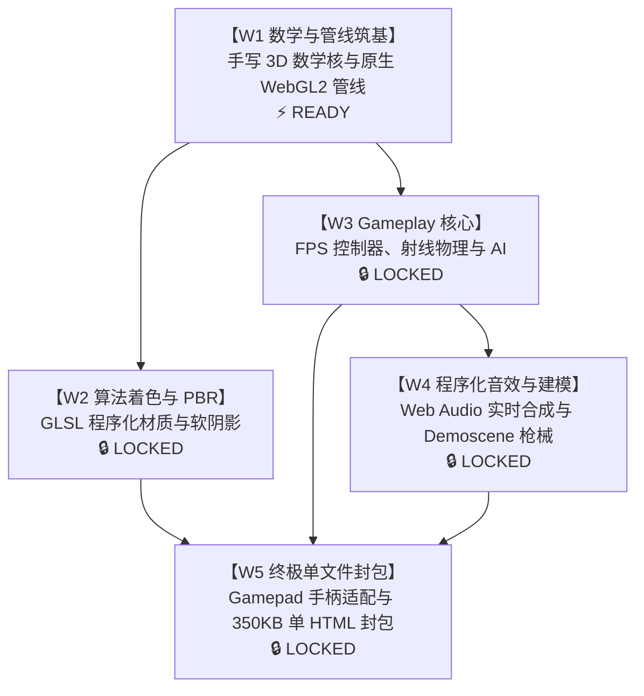

# 🎮 Web 3D 游戏引擎与极客单文件开发·实战任务总控台

> 本任务库将 **“理论阅读”**（图形学经典、引擎模式、着色器专著）与 **“动手造轮子”**（从零手写数学核、Shader、物理、AI、单文件封包）紧密绑定。  
> 🎯 **动态进度状态机**：由 [study-state.yaml](./study-state.yaml) 统一持久化，配合 `/mastery-planner` 进行工时微步派工与费曼通关。

---

## 依赖拓扑图 (DAG Workflow)

> **架构解耦亮点**：完成 `W1` 筑基后，**Gameplay 管线 (W3)** 与 **着色器渲染管线 (W2)** 彻底解耦并行！无需等待漫长的 PBR 调试即可先用纯色白模验证极其爽快的第一人称手感与物理碰撞。

---

## 阶段任务全景矩阵 (Milestone Tasks Matrix)

| 阶段代号 | 核心攻坚领域 | 对应理论书籍 / 权威材料 | 动手实践项目 | 状态 | 任务清单与打卡入口 |
| :---: | :--- | :--- | :--- | :---: | :--- |
| **W1** | **数学筑基与 WebGL2 渲染管线** | 《GAMES101》第 1-4 讲 《WebGL 编程指南》第 1-7 章 | 手写 3D 数学核 + 纯 Canvas 软件光栅化器 + 原生 WebGL 2 三角形 | ⚡ 就绪 | [👉 阶段一任务清单](./stage1-math-and-webgl.md) |
| **W2** | **GLSL 着色器、程序化材质与 PBR** | [The Book of Shaders] 《Real-Time Rendering 4th》第 9 章 | 纯代码程序化雨夜路面 + PCSS 高级软阴影 + AgX 电影级色调映射 | 🔒 待解锁 | [👉 阶段二任务清单](./stage2-shaders-and-pbr.md) |
| **W3** | **FPS 核心系统、物理碰撞与 AI** | 《Game Programming Patterns》 （游戏编程模式） | 手感细腻的 FPS 控制器 + 射线碰撞检测 + 双形态敌人 AI 状态机 | 🔒 待解锁 | [👉 阶段三任务清单](./stage3-fps-engine-and-ai.md) |
| **W4** | **程序化音频与 Demoscene 建模** | MDN Web Audio API Inigo Quilez 算法建模文集 | 纯代码振荡器合成枪声音效 + 代码拼装枪械 + 3D 战术投影 HUD | 🔒 待解锁 | [👉 阶段四任务清单](./stage4-procedural-audio-and-pcg.md) |
| **W5** | **多端适配、极限压缩与单文件封包** | Vite / Rollup 单文件工程流 Gamepad API 规范 | 手柄/触屏适配 + 运行时性能基准 + 350KB 零外链单 HTML 封包 | 🔒 待解锁 | [👉 阶段五任务清单](./stage5-single-file-packaging.md) |

---

## 实践原则与学习闭环 (First Principles)

1. **拒绝黑盒，先手写再调库**：
   * 在使用 Three.js 的 `Matrix4` 之前，必须先亲手实现矩阵乘法与透视除法；在调用高级材质前，必须亲手在 GLSL 中写过兰伯特漫反射与噪声采样。
2. **读一章书，写一个可运行的 Demo**：
   * 每一个知识点必须对应一个可以在浏览器中打开、交互、并能看到视觉或控制反馈的 `.html` 页面。
3. **沉淀在本地**：
   * 所有代码直接在本项目或本地目录下完成演练，逐步拼接，最终融合成完整的 3A 原型。
