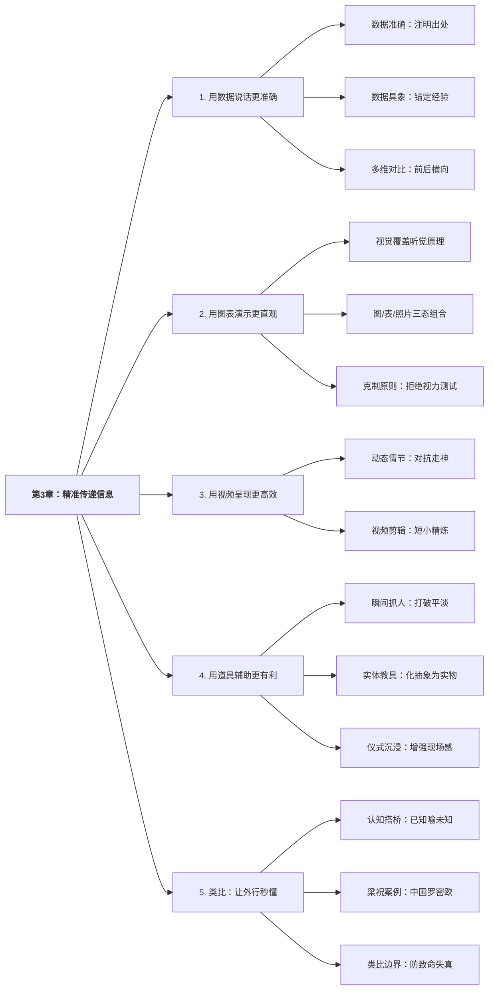

# 《成为讲书人：阅读和表达的个人精进法》- 第 3 章研读

- **章节**：第 3 章 如何精准传递书中的信息
- **阅读日期**：2026-11-17
- **所属领域**：`thinking` (思维与方法论)

---

## 🗺️ 全章主干结构雷达 (Full Spectrum Radar)
>
> 基于原书原文探测，第 3 章系统构建了“信息精准交付”的 5 大感知工具箱：

---

## 🎯 深度研读思辨探针 (深度激发思考·不限题数)

> 💡 **导读原则**：不拘泥于固定题目数量，聚焦于刺穿作者观点的边界、机理、隐秘矛盾与现实落地。选择最能引发您共鸣的题目深入作答，亦可自由发挥。

### 探针 1【数据维度 · 具象化与数字陷阱】
>
> 原文线索：作者强调“数据是客观事实不容争辩，带来压倒性说服力；要将抽象数据具象化”。

- **思辨方向**：
  1. 面对极端数字（如“几万亿规模”、“算法耗时 0.001ms”），大脑天生钝化。**如何把看不见摸不着的抽象量级，换算成人体可感知的生活度量？**
  2. 数据虽然不撒谎，但人会选择性呈现数据（“平均数陷阱”、“辛普森悖论”）。在讲书或技术分享中，**如何警惕用表面漂亮的数据掩盖底层真相？求真与说服力的红线在哪里？**
- **我的回答/笔记**：
  
---

### 探针 2【图表维度 · 视觉压制力与架构降维】
>
> 原文线索：科学研究表明当视觉与听觉信息不一致时，视觉会覆盖听觉；图表包含图、表、照片三种形式。

- **思辨方向**：
  1. 为什么很多经典的架构图（如 TCP/IP 协议栈分层图、Linux 内核拓扑）只有极简的黑白方块和单向箭头，却比花里胡哨的商业 PPT 更有生命力？
  2. 什么样的图表才能做到**“3 秒内传达单一核心逻辑”**，而不是把受众逼进阅读疲劳的“视力测试表”？
- **我的回答/笔记**：
  
---

### 探针 3【视频维度 · 动态刺激 vs 深度思考悖论】
>
> 原文线索：TED 演讲限定 18 分钟因为注意力会枯竭，但 2 小时电影却能让人全神贯注，因为电影有动态画面与音效。

- **思辨方向**：
  1. 电影虽好看，但看完第二天往往只记得模糊轮廓，记不住深刻推导；文字虽枯燥，却能反复停顿做深度逻辑推演。**视频的视听刺激是否在降低理解门槛的同时，也削弱了受众主动深度思考的能力？**
  2. 在没有条件制作/剪辑视频时（如写技术博文或录音频），**如何用“动态代码演示 / 交互式动效”达到相同的认知唤醒？**
- **我的回答/笔记**：
  
---

### 探针 4【道具维度 · 实体隐喻与技术人的“数字道具”】
>
> 原文线索：乔布斯从牛皮纸信封抽出 MacBook Air，比尔·盖茨在 TED 打开装有蚊子的玻璃瓶。道具大到布景，小到一枚硬币。

- **思辨方向**：
  1. 道具的最高境界不是杂耍，而是**“把一个看不见的抽象指标或价值观，一击必杀地具象化”**。
  2. 对于单人写博文、做架构评审或录屏的技术人，并没有物理舞台。**什么能充当我们的“数字道具”？**（一个可运行的 5 行最小 Demo 原型？一段真实的 Wireshark 抓包报文？一个压测打挂的实时监控面板？）
- **我的回答/笔记**：
  
---

### 探针 5【类比维度 · 认知桥梁 vs 致命诅咒】
>
> 原文线索：周总理把越剧《梁祝》类比为“中国的《罗密欧与朱丽叶》”，让外宾瞬间秒懂文化内核。

- **思辨方向**：
  1. 任何类比都是“瘸腿”的。在解释严密的底层系统（如分布式共识、操作系统虚拟内存、认知双系统）时，**类比在什么时候会带来致命的理解偏差？**
  2. 类比是思考的脚手架。讲书人该**如何既用类比让外行破冰秒懂，又在关键时刻果断拆除脚手架，切回真实的物理与代码机制？**
- **我的回答/笔记**：
  
---

### 探针 6【全章批判 · 形式辅助 vs 思想骨架】
>
> 批判性审视：数据、图表、视频、道具、类比五大武器轮番轰炸。

- **思辨方向**：
  - 很多商业演讲秀过度痴迷于放酷炫视频、拿道具吸睛，这是否是一种“内容不够、形式来凑”的偷懒？
  - 在追求“硬核知识吸收与个人精进”的讲书人眼里，**形式辅助工具与思想深度的黄金平衡线到底划在哪里？**
- **我的回答/笔记**：
  
---

## 💡 个人随手摘录与自由思考 (Free Notes)
>
> 随时倾倒您的读书摘抄、原书金句、灵感火花或反差案例：

-
