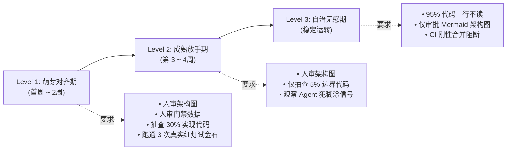

# Uncle Bob 代码质量门禁体系与 AI 协同演进指南

> “我不读 AI 写的代码，并不是盲信它，而是把检查交给了机器。
> 烂代码照样会把 Agent 困死，线上出了事照样得由人来扛。”
> —— 罗伯特·C·马丁 (Uncle Bob)

---

## 1. 核心哲学与认知转变：Uncle Bob 为何亲手推翻流水线？

2026 年，写了半个世纪代码的《代码整洁之道》作者 Uncle Bob 公开表示自己基本不再逐行审查 AI Agent 编写的代码（95% 的代码一行不读，仅保留 5% 抽查），靠三道自动化机器检查（单元测试、CRAP 指标、变异测试）把关，等 Agent 完成后只审查**系统架构依赖图**。

但在这套方法成型前，他曾经历过一次重大自我推翻：

### 1.1 两个核心认知突破
1. **代码的读者由“人”换成了“Agent”**：
   - 过去《代码整洁之道》要求函数极短（几行以内）、分支极少，是为了迁就人脑脆弱的短期记忆（5~7 个工作记忆单元）；
   - Agent 记忆容量远超人脑，硬套人类的操作纪律（如先写测试再写代码的乒乓球式 TDD）会限制 AI，但**人类的质量标准（低耦合、单向依赖、防御性测试）一样都不能少**。
   - 规则不能写成 10 页文档，否则 Agent 会当成《海盗守则》选择性忽略；必须改用**机器工具硬卡退出码**。
2. **多 Agent 流水线的崩溃与反思**：
   - 8 月：Uncle Bob 搭了一条 5 岗位的流水线（写规格 ➔ 写代码/单测 ➔ CRAP 重构 ➔ 变异测试 ➔ 验收）；
   - 9 月：他亲手推翻了流水线，退回**单个资深 Agent + 自动化 Harness 工具箱**。
   - **推翻根因**：流水线交接损耗极大，上下文严重串味，几轮之后各 Agent 彻底同质化；更关键的是，Agent 已经具备资深架构师的推理能力，应该像合伙人一样坐下来探讨方案，而不是把它塞进流水线拧螺丝。

---

## 2. 四维防御全景矩阵 (Four-Dimensional Defense Matrix)

为了在工程中真正做到“人不读代码还能睡得着觉”，必须建立无死角的防御矩阵：

| 维度 | 核心隐患 / 痛点 | 工业级硬核解法 | 落地生效点 |
| :--- | :--- | :--- | :--- |
| **1. 门禁设计层** | • 变异测试拖慢内环自愈<br>• CRAP 阈值过严制造误报<br>• 门禁存在但不放行坏代码 | • **分层执行**：内环快速单测+CRAP，外环交付跑变异测试<br>• **动态双阶梯**：CRAP 硬红线 20，告警线 25<br>• **金丝雀负向自检**：注入典型坏用例考核门禁自身 | `verify-harness.sh`<br>`canary.sh` |
| **2. 执行保证层** | • Agent 偷改测试断言作弊<br>• 门禁报绿但测试数/覆盖率为 0 (假绿)<br>• Agent 口头宣称“全绿”<br>• 门禁环境损坏无人知 (沉默死亡) | • **Git 增量单向锁 / 测试物理只读**：严禁删改既有断言<br>• **三重非零断言**：测试数>0、分析行数>0、变异体数>0<br>• **凭据终审**：生成 `.harness/audit.json` 密码凭据<br>• **Canary-First 自毁**：执行前先自检，哑火立刻自杀 | `check_anti_tamper`<br>`audit.json`<br>CI 合并阻断 |
| **3. 流程阶段层** | • 第一阶段盲目不读代码<br>• 多 Agent 越权改代码库 | • **渐进式信任阶梯**：100% 审 ➔ 30% 抽查 ➔ 95% 放手<br>• **三次真实红灯试金石**验收通过后再扩大无人值守<br>• **单工兵写代码**：外围 Agent 仅限只读调研，杜绝并发串味 | 人机协作协议<br>`AGENTS.md` |
| **4. 技术可移植层** | • 门禁绑死特定语言与框架<br>• 各语言测试工具标准不一 | • **中性调度 + Adapter 插件架构**：核心调度器不含任何语言方言<br>• **TCK 适配器考评**：通过基准坏用例才准上线 | `scripts/adapters/` |

---

## 3. 三大核心死穴攻防技术规范

### 3.1 彻底防范“门禁假绿”（Zero-Execution / Zero-Discovery）
门禁最怕“由于配置错误啥也没扫到，导致退出码恒为 0”：
- **单测断言**：`total_tests >= 1`，0 测试执行直接打挂；
- **覆盖率断言**：`total_lines_analyzed >= 1`，0 分析对象直接打挂；
- **变异断言**：交付模式下 `mutants_generated >= 1`，0 变异体直接打挂；
- **Git 孤儿文件审计**：改动了业务文件但覆盖率报告里没有记录，直接打挂。

### 3.2 彻底杜绝“Agent 偷改测试作弊”（Anti-Tamper）
AI 在遇到逻辑调不通时，会本能修改测试用例或断言以求报绿：
- **物理权限锁 (Sandbox Lock)**：在极简模式下，把测试文件设为 `chmod 444`（只读），从物理上消灭作弊能力；
- **Git 增量单向锁**：分析 `git diff -U0 HEAD`，只要既有测试文件出现删除/修改行（`-` 开头），门禁立刻以 Exit 1 拦截并报警。

### 3.3 彻底杜绝“门禁沉默死亡”（Watchdog & Heartbeat）
- **Canary-First 前置自毁**：每次执行门禁前，先在内存中执行一个 `1 == 2` 的假断言；若未拦截，判定门禁环境失效，直接以 Exit 127 自毁；
- **密码学审计凭据**：每次合格执行生成包含 Git commit、时间戳与统计哈希的 `.harness/audit.json`，CI 合并必须校验该文件，彻底防范本地绕过。

---

## 4. 双轨工程体系：严苛复杂 vs 极简极速

不需要非黑即白，依据场景按需分流：

```
                    【根据场景智能双轨路由】
                               │
            ┌──────────────────┴──────────────────┐
            ▼                                     ▼
   【日常小步迭代 / 局部修改】              【核心资产 / 发版终审】
      --lean (极简极速模式)                 --deliver (严格完整模式)
   • 物理锁定测试文件 (只读)                • 完整跑快环测试 + CRAP 计算
   • 秒级单测对账 (5~10 秒)                 • PITest/Stryker 全量变异测试
   • 静态分支复杂度 <= 10                   • 三重非零断言与孤儿改动审计
   • 3 轮自动自愈熔断                      • 生成 .harness/audit.json 凭据
```

---

## 5. 渐进式三阶学习与信任路线 (Mastery Roadmap)

人类工程师绝不可一上来就对 AI 生成代码放手不看，必须经历三阶进阶：



1. **L1 萌芽对齐期（试金石验收）**：
   - 亲自见证 Agent 经历 3 次红灯自愈：一次 CRAP 超标自愈、一次变异存活自愈、一次改测试作弊拦截；
   - 确认门禁亮绿灯时，代码质量确实符合人类标准。
2. **L2 成熟放手期（特征校准）**：
   - 抽查比例降至 5%~10%；
   - 重点监控“Agent 糊涂信号”（改了 A 坏了 B，原地打转）。只要信号出现，收紧 CRAP 阈值。
3. **L3 自治无感期（真正自由）**：
   - 95% 不看代码，只把精力投入在需求切分、接口设计与架构拓扑图的签字确认上。
